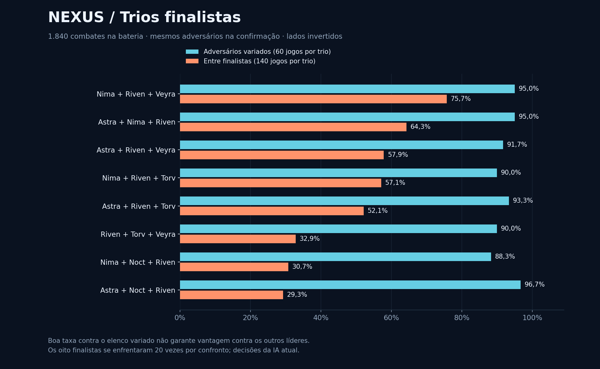
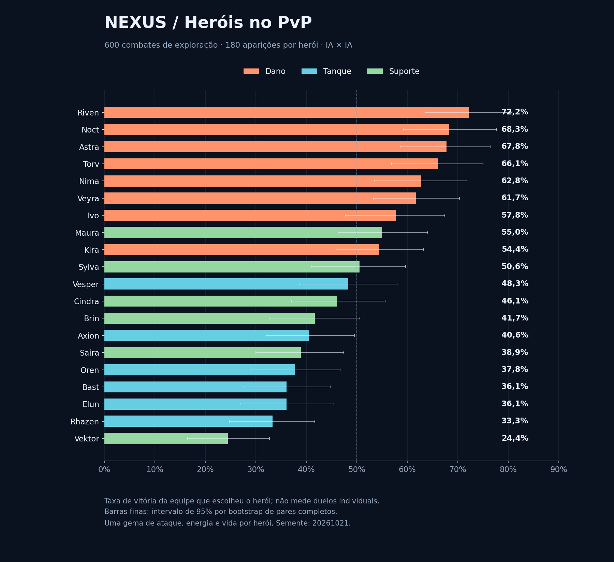

# Nexus 0.14 — simulação de equilíbrio PvP

**1.840 combates completos e 70.311 ações.** O trio que liderou os confrontos entre finalistas foi **Nima + Riven + Veyra**: 106/140 vitórias (75,7%). Contra adversários variados, venceu 57/60 (95,0%).

O herói com a maior taxa observada foi **Riven**, com 130/180 (72,2%) na amostra de exploração. Cada um dos 20 heróis teve exatamente 180 aparições nessa etapa. Os jogos dirigidos aos finalistas não entram nesse ranking, para evitar favorecer os heróis escolhidos para a final.

## Condições e alcance

- Motor autoritativo do servidor PvP e IA atual dos dois lados; atributos normais e sem bônus de campanha.
- Cada herói equipa uma Brasa (+4% ATQ), um Pulso (+8 EN inicial) e uma Seiva (+5% VIDA). Não há otimização de engastes nesta bateria.
- São permitidos papéis e classes repetidos. Formação fixa: tanques, suportes e danos; ordem alfabética dentro do papel. A posição por si só não obriga o rival a atacar o tanque.
- Cada confronto é repetido com a mesma semente e lados invertidos. Os resultados de um par são correlacionados.
- 600 jogos exploratórios cobrem 600 composições distintas. As 1.140 combinações possíveis são enumeradas para auxiliar a pré-seleção; não foram todas comparadas exaustivamente.
- Um modelo regularizado de força dos heróis sugere dez candidatos. Outros dez vêm de resultados inesperadamente bons na exploração. Esse modelo escolhe candidatos; os winrates publicados vêm de combates executados.
- Os 20 candidatos enfrentam cinco adversários compartilhados, nos dois lados (200 jogos). Os 8 candidatos com taxa igual ou superior à terceira colocação avançam.
- Os 8 finalistas enfrentam 30 adversários novos compartilhados, nos dois lados (480 jogos). Depois jogam todos contra todos: dez pares de sementes por confronto (560 jogos).
- O plano inicial tinha cerca de 1.000 jogos. Os empates exigiram ampliar a final. O líder da final é definido pelo winrate no todos contra todos; a taxa contra adversários variados é apresentada separadamente.
- Esta é uma busca amostral e adaptativa com IA; não prova o melhor trio global nem o maior winrate de jogadores humanos. Outras gemas e formações podem mudar os resultados. Não foi aplicada mudança de balanceamento.

## Trios

| Trio | Contra adversários variados | Entre os 8 finalistas |
| --- | ---: | ---: |
| Nima + Riven + Veyra | 57/60 · 95,0% | 106/140 · 75,7% |
| Astra + Nima + Riven | 57/60 · 95,0% | 90/140 · 64,3% |
| Astra + Riven + Veyra | 55/60 · 91,7% | 81/140 · 57,9% |
| Nima + Riven + Torv | 54/60 · 90,0% | 80/140 · 57,1% |
| Astra + Riven + Torv | 56/60 · 93,3% | 73/140 · 52,1% |
| Riven + Torv + Veyra | 54/60 · 90,0% | 46/140 · 32,9% |
| Nima + Noct + Riven | 53/60 · 88,3% | 43/140 · 30,7% |
| Astra + Noct + Riven | 58/60 · 96,7% | 41/140 · 29,3% |

**Astra + Noct + Riven** teve a maior taxa contra adversários variados (96,7%), mas não liderou os confrontos entre finalistas. A diferença de uma vitória nessa confirmação é pequena; essa taxa sozinha não define dominância.



### Confrontos do campeão

| Adversário | Vitórias do campeão |
| --- | ---: |
| Astra + Nima + Riven | 13/20 |
| Astra + Riven + Veyra | 14/20 |
| Nima + Riven + Torv | 16/20 |
| Astra + Riven + Torv | 13/20 |
| Riven + Torv + Veyra | 19/20 |
| Nima + Noct + Riven | 15/20 |
| Astra + Noct + Riven | 16/20 |

## Heróis — somente exploração equilibrada

| Herói | Classe | Função | Vitórias / aparições | Winrate | Sem espelho do herói |
| --- | --- | --- | ---: | ---: | ---: |
| Riven | Sombrio | Dano | 130/180 | 72,2% | 116/152 · 76,3% |
| Noct | Sombrio | Dano | 123/180 | 68,3% | 119/172 · 69,2% |
| Astra | Arcano | Dano | 122/180 | 67,8% | 112/160 · 70,0% |
| Torv | Ígneo | Dano | 119/180 | 66,1% | 105/152 · 69,1% |
| Nima | Natural | Dano | 113/180 | 62,8% | 101/156 · 64,7% |
| Veyra | Ígneo | Dano | 111/180 | 61,7% | 95/148 · 64,2% |
| Ivo | Arcano | Dano | 104/180 | 57,8% | 94/160 · 58,8% |
| Maura | Sombrio | Suporte | 99/180 | 55,0% | 79/140 · 56,4% |
| Kira | Técnico | Dano | 98/180 | 54,4% | 78/140 · 55,7% |
| Sylva | Natural | Suporte | 91/180 | 50,6% | 79/156 · 50,6% |
| Vesper | Sombrio | Tanque | 87/180 | 48,3% | 75/156 · 48,1% |
| Cindra | Ígneo | Suporte | 83/180 | 46,1% | 71/156 · 45,5% |
| Brin | Natural | Suporte | 75/180 | 41,7% | 63/156 · 40,4% |
| Axion | Técnico | Tanque | 73/180 | 40,6% | 55/144 · 38,2% |
| Saira | Arcano | Suporte | 70/180 | 38,9% | 52/144 · 36,1% |
| Oren | Natural | Tanque | 68/180 | 37,8% | 54/152 · 35,5% |
| Bast | Técnico | Tanque | 65/180 | 36,1% | 47/144 · 32,6% |
| Elun | Arcano | Tanque | 65/180 | 36,1% | 55/160 · 34,4% |
| Rhazen | Ígneo | Tanque | 60/180 | 33,3% | 40/140 · 28,6% |
| Vektor | Técnico | Suporte | 44/180 | 24,4% | 32/156 · 20,5% |

“Sem espelho” exclui jogos em que o mesmo herói está nas duas equipes. O ranking principal usa todas as aparições e sempre mede vitória da equipe, não a força isolada em 1 contra 1.

O intervalo de 95% por reamostragem de pares para Riven foi 63,5% a 80,7%. Os intervalos dos primeiros colocados se sobrepõem: a liderança pontual não demonstra superioridade estatística sobre todos os demais heróis.



## Diagnóstico

- Nima expõe a defesa e aplica sangramento. Veyra aproveita sangramento/queimadura e tem dano em área. Riven combina sangramento, execução e roubo de vida. O trio tem velocidades 114, 112 e 107, permitindo pressão antes de muitos suportes e tanques.
- Sangramento reduz a cura recebida em 35%. A redução da defesa e os bônus de execução ajudam a transformar essa pressão em eliminações. Esses mecanismos existem nas regras; esta bateria não isola a contribuição causal de cada um.
- Composições com três atacantes foram as melhores na exploração. Isso merece revisão da utilidade de proteção e da IA defensiva antes de ajustar apenas o dano de um herói.

| Composição por função | Vitórias / aparições | Winrate |
| --- | ---: | ---: |
| 3 Dano / 0 Tanque / 0 Suporte | 60/66 | 90,9% |
| 2 Dano / 1 Tanque / 0 Suporte | 110/152 | 72,4% |
| 2 Dano / 0 Tanque / 1 Suporte | 133/190 | 70,0% |
| 1 Dano / 1 Tanque / 1 Suporte | 155/308 | 50,3% |
| 1 Dano / 0 Tanque / 2 Suporte | 52/122 | 42,6% |
| 1 Dano / 2 Tanque / 0 Suporte | 47/128 | 36,7% |
| 0 Dano / 1 Tanque / 2 Suporte | 23/98 | 23,5% |
| 0 Dano / 0 Tanque / 3 Suporte | 3/16 | 18,8% |
| 0 Dano / 2 Tanque / 1 Suporte | 15/94 | 16,0% |
| 0 Dano / 3 Tanque / 0 Suporte | 2/26 | 7,7% |

Nas finais, o lado 0 venceu 416/560 jogos (74,3%). O desempate atual de velocidade prioriza esse lado; finais com heróis repetidos são sensíveis a isso. A inversão de lados dá a cada trio o mesmo número de partidas em cada lado. O efeito específico do desempate ainda exige um teste isolado; este número também inclui o restante da dinâmica da IA e da aleatoriedade.

Prioridades para um próximo ajuste: verificar a iniciativa/desempate; melhorar decisões de proteção e o tempo de entrada dos tanques; revisar Vektor e Rhazen; repetir a bateria antes/depois com as mesmas sementes e depois testar engastes e jogadores humanos.

## Reproduzir e auditar

```bash
node scripts/tournament-pvp.mjs --output artifacts/tournament-014 --seed 20261021 --gems balanced
python3 scripts/report-tournament.py artifacts/tournament-014 docs/balance-014
```

A primeira linha executa os combates. A segunda gera este relatório e os gráficos com NumPy e Matplotlib. Os logs simulados são gravados em arquivos separados; não são enviados ao Render ou ao Supabase nem alteram os saves da campanha.

Regras `0.11.0`; PvP `pvp-test-1`; combate da revisão `a9c0c3c9466bba3e6e410e8ba2032c1d7746a56d`. O número 0.14 é a versão do cliente: a atualização gráfica não mudou a versão das regras.

Impressão do motor: `68588d8e71220b48c46d45e2a2ff5fd2c62e2358599b7e35c79bc609f1ce8437`.

- [Resumo estruturado](summary.json)
- [Ranking dos heróis em CSV](heroes.csv)
- [Ranking dos trios em CSV](trios.csv)
- [Comandos, sementes, atributos finais e hashes dos 1.840 jogos](replays.ndjson.gz)
- [Incerteza estatística da amostra de heróis](uncertainty.json)

Verificações do simulador: os 1.840 jogos terminaram; os recursos foram checados após cada ação; catálogo, regras e gemas coincidem com o Godot; 11 replays de fases diferentes foram reconstruídos com escolha da IA e hash final idênticos. Reexecuções de verificação não aumentam a amostra estatística.
