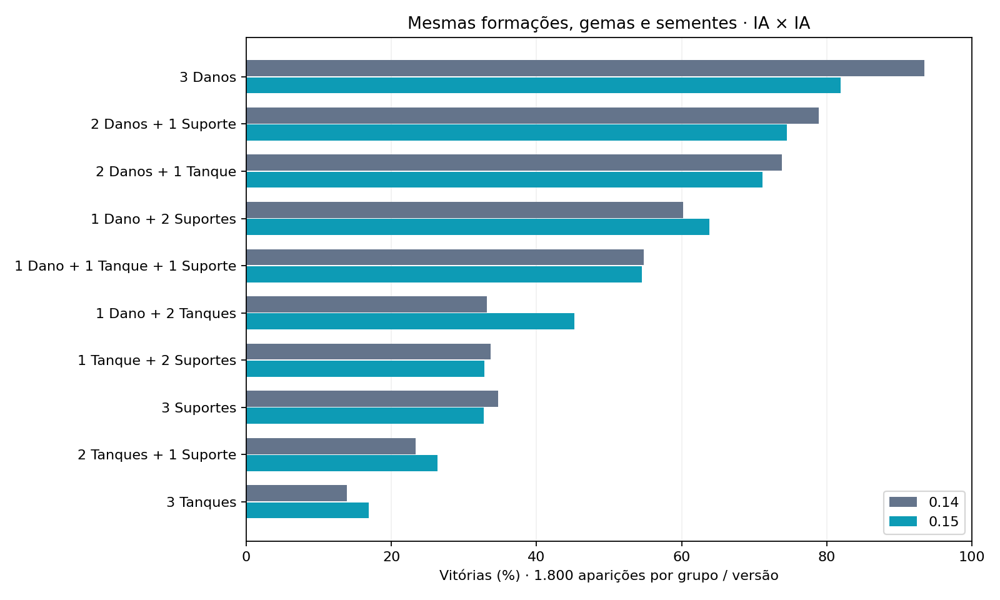

# Balanceamento 0.15: proteção, risco e decisões

Regras `0.15.0` · fonte `bdf63213d092f4e664582c263973a3bd77b9cba3` · fingerprint `24bfd1a18f421ac1558263a19f326a8b818748bb6d0c959afe6027f0f1024866`.

Foram concluídos **36,108 combates**, com **1,945,010 ações** e todos os 1.140 trios cobertos. O script verifica que os 19.800 confrontos controlados e os 9.000 mistos usam exatamente as mesmas equipes, gemas, sementes e inversões de lado da amostra 0.14. A política da IA mudou junto com o balanceamento; estes resultados medem o pacote completo, sem atribuir o efeito a uma mudança isolada.

## Regras aplicadas

- Escudos: camadas independentes por 2 rodadas globais, limite total preservado em 25% da vida. Uma aplicação na rodada 1 vence no início da 3; outra na 2 vence na 4. Novas aplicações não renovam camadas antigas. Golpes consomem primeiro as antigas.
- Vesper: provocação e riposta por 2 turnos pessoais. O tanque provocador perde 25% da própria defesa durante a postura. A penalidade termina com ela e não pode ser purificada isoladamente. Ataques individuais são restringidos aos provocadores vivos; área continua atingindo os adversários.
- Tanques: ataque base cerca de +8%, refletido nos básicos, habilidades ofensivas e ripostas. O primeiro tanque na formação dá Cobertura aos outros aliados por 2 turnos pessoais deles na abertura. Desvia 25% do golpe individual ao protetor vivo, sem empilhar múltiplos protetores ou bloquear área.
- Dano: vida base cerca de −6%, com arredondamento por herói. Ataque e poderes ofensivos preservados.
- Suportes: atributos e habilidades preservados.
- IA: avalia dano estimado, finalizações, prioridade de suporte, afinidade, escudos, cobertura, combos, cura efetiva e proteção de aliados vulneráveis. Respeita provocação, custo e recarga; não consome o RNG ao planejar.

## Amostra mista comparável

Cada grupo joga contra os outros nove com peso igual, 1.800 aparições por grupo e diferentes receitas individuais de gemas. Não corresponde à distribuição de uma fila humana.

| Funções | 0.14 | 0.15 |
|---|---:|---:|
| 3 Danos | 93,5% | 81,9% |
| 2 Danos + 1 Suporte | 78,9% | 74,5% |
| 2 Danos + 1 Tanque | 73,8% | 71,2% |
| 1 Dano + 2 Suportes | 60,2% | 63,8% |
| 1 Dano + 1 Tanque + 1 Suporte | 54,8% | 54,6% |
| 1 Dano + 2 Tanques | 33,2% | 45,2% |
| 1 Tanque + 2 Suportes | 33,7% | 32,8% |
| 3 Suportes | 34,7% | 32,8% |
| 2 Tanques + 1 Suporte | 23,3% | 26,3% |
| 3 Tanques | 13,9% | 16,9% |



Três danos continuam fortes na média. A melhora dos tanques abriu respostas, mas **o jogo ainda não pode ser considerado equilibrado**. Equipes sem dano seguem fracas; não se pretende que três tanques tenham a mesma capacidade ofensiva de uma equipe completa.

## Final entre builds selecionadas

Os candidatos e vencedores da seleção são recalculados em cada versão; esta fase não tem adversários idênticos à final 0.14. Cada build enfrenta as outras nove por 40 jogos, total de 360 aparições. A seleção é amostral; não prova o melhor trio global.

| Funções | Trio selecionado | Vitória na final 0.15 |
|---|---|---:|
| 2 Danos + 1 Tanque | Vesper + Astra + Veyra | 87,5% (315/360) |
| 1 Dano + 2 Tanques | Axion + Vesper + Kira | 71,1% (256/360) |
| 1 Dano + 1 Tanque + 1 Suporte | Axion + Maura + Nima | 66,9% (241/360) |
| 2 Danos + 1 Suporte | Maura + Astra + Nima | 64,7% (233/360) |
| 3 Danos | Riven + Torv + Veyra | 64,4% (232/360) |
| 1 Dano + 2 Suportes | Maura + Vektor + Riven | 59,7% (215/360) |
| 1 Tanque + 2 Suportes | Vesper + Cindra + Maura | 47,8% (172/360) |
| 2 Tanques + 1 Suporte | Elun + Vesper + Cindra | 18,6% (67/360) |
| 3 Suportes | Cindra + Maura + Sylva | 15,0% (54/360) |
| 3 Tanques | Elun + Rhazen + Vesper | 4,2% (15/360) |

Na final, Vesper + Astra + Veyra, com três gemas de energia em cada herói, venceu 39/40 contra Riven + Torv + Veyra, com três gemas de vida em cada herói. Esse confronto mostra uma resposta concreta ao trio de dano selecionado; não garante vitória contra qualquer trio de dano.

## Reproduzir e conferir

```bash
npm ci
npm run sync:godot
node scripts/simulate-role-gems.mjs --output artifacts/roles-gems-015 --seed 20261021
python3 scripts/report-balance-015.py
```

O motor confere limites de recursos, conclusão e replays. Há 59 replays completos amostrados em `replay-samples.ndjson.gz`; `matches.ndjson.gz` guarda resumos de todos os confrontos. `summary.json` contém os resultados por perfil, intervalos, matriz e limites do estudo. Nenhum desses dados é escrito nos logs reais de jogadores.

Os históricos locais de laboratório 0.11 ficam preservados em arquivos próprios; a nova versão inicia arquivos 0.15 para evitar misturar regras. Os registros do servidor PvP continuam separados e identificados pela versão das regras.
