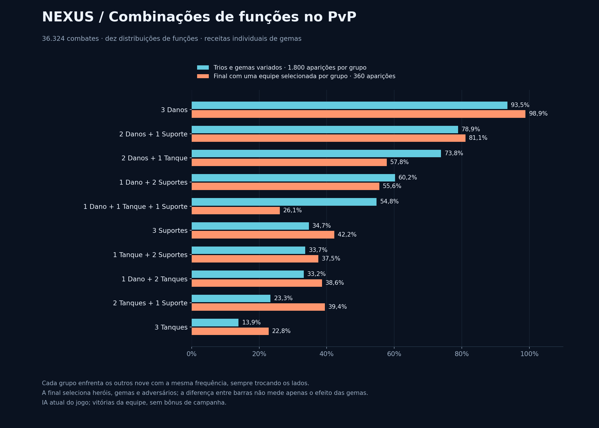
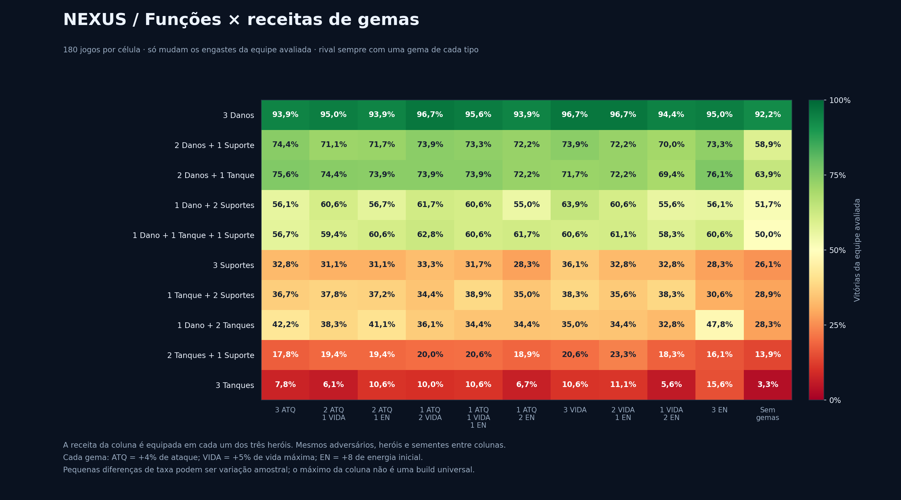
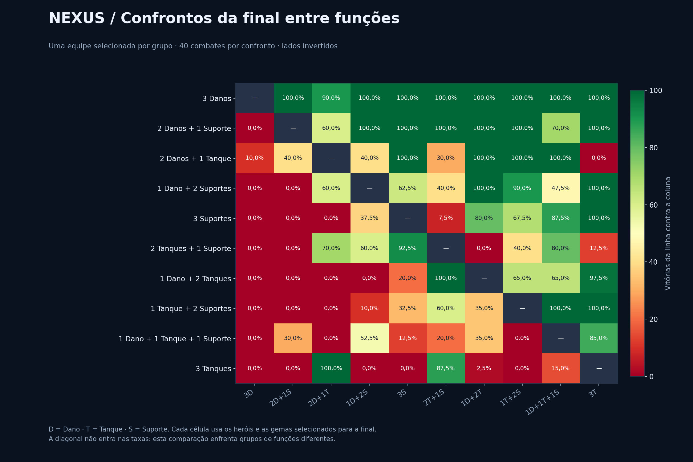

# Nexus 0.14 — funções e combinações de gemas

**36.324 combates completos, 2.110.619 ações e 1.140 trios de heróis cobertos.** Com a IA atual, a distribuição dominante foi **3 Danos**: 1683/1800 vitórias (93,5%) na etapa com gemas individuais variadas. Na final com uma equipe selecionada por grupo, essa distribuição fez 356/360 (98,9%).

## Comparação principal: heróis e engastes variados

Cada grupo tem 1.800 aparições e enfrenta os outros nove grupos com a mesma frequência. Os trios vêm de baralhos completos embaralhados; cada herói recebe uma das dez receitas válidas independentemente. Os lados são invertidos. Essa população dá o mesmo peso a cada distribuição de funções, independentemente de quantos trios existem dentro dela.

| Funções | Vitórias / aparições | Winrate | Intervalo 95% por pares |
| --- | ---: | ---: | ---: |
| 3 Danos | 1683/1800 | 93,5% | 92,0%–94,9% |
| 2 Danos + 1 Suporte | 1420/1800 | 78,9% | 76,8%–81,0% |
| 2 Danos + 1 Tanque | 1329/1800 | 73,8% | 71,6%–76,0% |
| 1 Dano + 2 Suportes | 1084/1800 | 60,2% | 57,8%–62,6% |
| 1 Dano + 1 Tanque + 1 Suporte | 986/1800 | 54,8% | 52,2%–57,4% |
| 3 Suportes | 625/1800 | 34,7% | 32,4%–37,0% |
| 1 Tanque + 2 Suportes | 606/1800 | 33,7% | 31,4%–36,2% |
| 1 Dano + 2 Tanques | 597/1800 | 33,2% | 30,6%–36,1% |
| 2 Tanques + 1 Suporte | 420/1800 | 23,3% | 21,1%–25,6% |
| 3 Tanques | 250/1800 | 13,9% | 12,1%–15,8% |

Os intervalos usam 2.000 reamostragens dos pares completos, estratificados por confronto de funções. São condicionais aos adversários e às decisões da IA amostrados. Não incluem jogos contra o mesmo grupo de funções; não são uma previsão do winrate de uma fila humana.



## Efeito das gemas em condições controladas

O rival equipa uma Brasa, uma Seiva e um Pulso em cada herói. Só os engastes da equipe avaliada mudam. Os mesmos heróis, adversários e sementes são usados para cada receita; os lados são invertidos. Cada receita é aplicada aos três heróis da equipe e tem 180 partidas por grupo.

Gemas disponíveis no PvP atual: **Brasa/vermelha = +4% ATQ; Seiva/verde = +5% VIDA; Pulso/azul = +8 de energia inicial**. Os bônus iguais somam antes do arredondamento. Três Brasa dão +12% ATQ; três Seiva dão +15% VIDA; três Pulso dão +24 EN inicial. Energia inicial não significa regeneração por turno.

São dez receitas de três gemas por herói. Permutações de posição nos engastes não alteram os atributos. Os três heróis podem combinar receitas diferentes, resultando em 1.000 alocações possíveis por trio; essa combinação individual é amostrada na etapa principal, não varrida exaustivamente. O controle adicional sem gemas fica separado.

| Funções | Maior taxa observada nas receitas uniformes | Vitórias |
| --- | --- | ---: |
| 3 Danos | 1 ATQ + 2 VIDA; 3 VIDA; 2 VIDA + 1 EN | 174/180 · 96,7% |
| 2 Danos + 1 Suporte | 3 ATQ | 134/180 · 74,4% |
| 2 Danos + 1 Tanque | 3 EN | 137/180 · 76,1% |
| 1 Dano + 2 Suportes | 3 VIDA | 115/180 · 63,9% |
| 1 Dano + 1 Tanque + 1 Suporte | 1 ATQ + 2 VIDA | 113/180 · 62,8% |
| 3 Suportes | 3 VIDA | 65/180 · 36,1% |
| 1 Tanque + 2 Suportes | 1 ATQ + 1 VIDA + 1 EN | 70/180 · 38,9% |
| 1 Dano + 2 Tanques | 3 EN | 86/180 · 47,8% |
| 2 Tanques + 1 Suporte | 2 VIDA + 1 EN | 42/180 · 23,3% |
| 3 Tanques | 3 EN | 28/180 · 15,6% |

Esses máximos são taxas observadas, não prova de que uma receita seja superior por poucos pontos. O objetivo é verificar se mudar engastes muda a hierarquia das funções. **Três danos continuou forte em todas as dez receitas preenchidas; nenhuma receita tornou três tanques ou três suportes dominantes nessa amostra.**



### Exemplos que mudam a interpretação das gemas

- Três danos teve empate de 174/180 (96,7%) com uma gema de ataque + duas de vida, três de vida e duas de vida + uma de energia em cada herói. Três gemas de ataque ficou em 169/180 (93,9%). Gemas de vida também podem beneficiar atacantes.
- Três suportes teve seu maior valor com três gemas de vida por herói: 65/180 (36,1%). Três de energia teve 51/180 (28,3%).
- Três tanques teve seu maior valor com três gemas de energia por herói: 28/180 (15,6%). Três gemas de vida ficou em 19/180 (10,6%).
- A energia realmente alterou o uso de supremos nesta IA: em três tanques, três gemas de energia produziram média de 3,62 supremos por equipe/partida; três gemas de vida, 1,81. Mais supremos não garantiu vitórias suficientes para competir com três atacantes.

## Final com equipes e gemas selecionadas

Na etapa principal, foram selecionados três trios candidatos por grupo pela margem inferior de Wilson, totalizando 30 trios. Eles receberam receitas equilibradas, ataque, vida, energia, a melhor receita uniforme do grupo e uma receita por herói estimada na amostra de treinamento. Receitas duplicadas foram removidas, restando 159 builds.

Cada build enfrentou 18 adversários novos compartilhados dentro de seu grupo (dois de cada uma das nove funções rivais), com lados invertidos: 36 jogos. A melhor candidata de cada grupo avançou. Essa escolha é amostral e não esgota todas as possibilidades de heróis/gemas. Todos os dez selecionados então se enfrentaram com 20 sementes novas, nos dois lados: 40 partidas por confronto e 360 por grupo.

| Funções | Trio selecionado | Gemas por herói | Vitórias na final |
| --- | --- | --- | ---: |
| 3 Danos | Ivo + Kira + Nima | ivo: 3 ATQ; kira: 3 ATQ; nima: 3 ATQ | 356/360 · 98,9% |
| 2 Danos + 1 Suporte | Sylva + Astra + Kira | sylva: 3 VIDA; astra: 3 VIDA; kira: 3 VIDA | 292/360 · 81,1% |
| 2 Danos + 1 Tanque | Bast + Riven + Veyra | bast: 3 VIDA; riven: 3 VIDA; veyra: 3 VIDA | 208/360 · 57,8% |
| 1 Dano + 2 Suportes | Brin + Maura + Astra | brin: 1 ATQ + 1 VIDA + 1 EN; maura: 1 ATQ + 1 VIDA + 1 EN; astra: 1 ATQ + 1 VIDA + 1 EN | 200/360 · 55,6% |
| 3 Suportes | Cindra + Maura + Sylva | cindra: 3 VIDA; maura: 3 VIDA; sylva: 3 VIDA | 152/360 · 42,2% |
| 2 Tanques + 1 Suporte | Axion + Vesper + Maura | axion: 3 ATQ; vesper: 3 ATQ; maura: 3 ATQ | 142/360 · 39,4% |
| 1 Dano + 2 Tanques | Axion + Vesper + Riven | axion: 3 ATQ; vesper: 3 ATQ; riven: 3 ATQ | 139/360 · 38,6% |
| 1 Tanque + 2 Suportes | Vesper + Cindra + Sylva | vesper: 3 VIDA; cindra: 3 VIDA; sylva: 3 VIDA | 135/360 · 37,5% |
| 1 Dano + 1 Tanque + 1 Suporte | Bast + Sylva + Astra | bast: 3 ATQ; sylva: 3 ATQ; astra: 3 ATQ | 94/360 · 26,1% |
| 3 Tanques | Elun + Rhazen + Vesper | elun: 3 EN; rhazen: 3 EN; vesper: 3 EN | 82/360 · 22,8% |

A final compara uma equipe selecionada de cada grupo, não a média de todos os trios daquela função. Também muda os heróis e adversários; a diferença para a etapa principal não pode ser atribuída apenas às gemas.



Exemplo de contra-composição na final: Elun + Rhazen + Vesper ganhou 40/40 jogos de Bast + Riven + Veyra. Isso descreve esse confronto de heróis e engastes; a taxa geral de três tanques continua sendo a da tabela.

## Leitura para o balanceamento

- A vantagem de três atacantes persistiu com gemas uniformes, receitas diferentes por herói e adversários selecionados por função. O problema não ficou restrito à configuração equilibrada do relatório anterior.
- Duas fontes de dano com um suporte foi a segunda distribuição nas duas etapas. Equipes com dois tanques ou sem atacante tiveram dificuldade, embora existam confrontos específicos favoráveis.
- A melhoria de vida mantém a pressão ofensiva dos atacantes e aumenta sua sobrevivência. Para tanques e suportes competirem, vale investigar o tempo de entrada da proteção, a eficiência das ações defensivas, o controle e as decisões da IA, além dos atributos.
- Esta simulação não separa causalmente todas essas mecânicas nem modela decisões de jogadores humanos. As taxas altas vêm de uma população igualmente distribuída entre dez funções; uma fila cheia de três atacantes teria outro winrate de referência.

Nenhum atributo, habilidade, gema ou comportamento da IA foi alterado. Os resultados não são enviados aos logs de jogadores, Render, Supabase ou saves da campanha.

## Protocolo e auditoria

| Etapa | Combates | Ações |
| --- | ---: | ---: |
| Receitas controladas | 19.800 | 1.144.505 |
| Engastes individuais variados | 9.000 | 525.137 |
| Seleção independente de candidatas | 5.724 | 329.801 |
| Final de funções selecionadas | 1.800 | 111.176 |

- Todos os combates usam o motor autoritativo do servidor PvP, com atributos normais e a IA atual para os dois lados.
- São permitidas classes repetidas, sem herói duplicado dentro da equipe. Formação fixa: tanque, suporte, dano; ordem alfabética dentro da função. A posição não força um ataque contra o tanque.
- Foram verificados vida, energia e escudo após cada uma das 2.110.619 ações. Nenhum combate ficou incompleto. Catálogo, regras e gemas correspondem aos arquivos do Godot.
- 59 replays completos distribuídos entre as fases foram reconstruídos: mesma escolha da IA, comandos, vencedor e hash final.
- Os registros de partidas guardam as duas equipes na ordem original; `swap: 1` indica inversão ao executar o jogo. `winner` é normalizado à ordem original, e `side0Won` é o lado real. Os replays completos já armazenam a ordem de execução.
- Os testes controlados repetem os mesmos adversários e sementes entre receitas, favorecendo comparações pareadas. Essas repetições não são observações independentes para comparar receitas.

```bash
node scripts/simulate-role-gems.mjs --output artifacts/roles-gems-014 --seed 20261021
python3 scripts/report-role-gems.py artifacts/roles-gems-014 docs/roles-gems-014
```

Cliente 0.14; regras `0.11.0`; PvP `pvp-test-1`; revisão base `4dd509b99ccafc8117257cfd9d06aaa5625200c1`. A versão das regras permanece 0.11.0 porque as atualizações visuais não alteraram o combate.

Impressão do motor: `68588d8e71220b48c46d45e2a2ff5fd2c62e2358599b7e35c79bc609f1ce8437`.

- [Resumo estruturado e todas as candidatas](summary.json)
- [Ranking de funções em CSV](roles.csv)
- [Receitas de gemas em CSV](gems.csv)
- [Sementes, equipes, gemas, resultados e hashes de todos os jogos](matches.ndjson.gz)
- [Amostras com comandos completos para replay](replay-samples.ndjson.gz)
