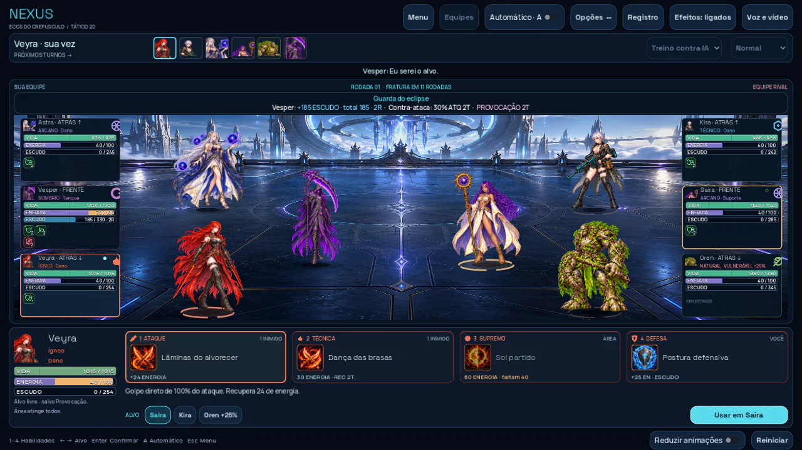

# Nexus 0.15 — escudos, proteção e risco

A provocação faz o que foi combinado: prende os ataques individuais no provocador, mas **reduz em 25% a defesa do próprio tanque enquanto durar**. Vesper provoca e contra-ataca por dois turnos pessoais. A penalidade aparece em vermelho no HUD, termina com a postura e não pode ser purificada separadamente. Área continua atingindo a equipe.

Escudos agora somam em camadas com validade independente de duas rodadas globais. Rodada 1 → expira no início da 3; rodada 2 → expira no início da 4. O total continua limitado a 25% da vida. A camada mais antiga absorve primeiro; uma aplicação nova não renova as anteriores. A barra informa as rodadas, o tooltip detalha as camadas e os recibos preservam o saldo após uma expiração parcial.

Tanques receberam cerca de 8% de ataque base a mais, melhorando também suas habilidades ofensivas. O primeiro tanque da formação concede Cobertura aos demais aliados na abertura por dois turnos pessoais deles: desvia 25% do golpe individual ao protetor vivo. Não acumula protetores e não intercepta área. Personagens de dano receberam cerca de 6% menos vida, com arredondamento por herói; seus ataques e poderes foram preservados. Atributos e habilidades dos suportes foram preservados.

A IA compara ações disponíveis, finalizações, afinidades, combos, proteção, escudos e cura efetiva. Prioriza ameaças de suporte quando há uma boa oportunidade, termina alvos vulneráveis e protege aliados feridos. O planejamento não altera a batalha nem avança o gerador de críticos.

## Áudio e interface

Vozes e efeitos usam explicitamente a reprodução pelo mixer do Godot na exportação Web. O limitador de efeitos que silenciava esse canal no Web sem threads foi substituído por margem de volume nessa plataforma; o limitador nativo foi preservado. Nas configurações **Áudio e vídeo**, há controles separados e os botões **Ouvir Vesper** e **Ouvir golpe**. Os testes de navegador medem PCM real na saída de áudio; o indicador `playing` sozinho não é suficiente para verificar som.



O HUD de combate ganhou ajustes de espaçamento para manter o botão de iniciar dentro da janela. Os novos dados do laboratório usam arquivos 0.15; os arquivos antigos ficam preservados. Campanha, inventário, gemas, arte, animações e estudo 3D arquivado continuam presentes.

[Resultados das simulações, dados e limites](../docs/balance-015/README.md).

## Atualizar e jogar

Esta é a versão **0.15 do Nexus**; a numeração do aplicativo Trono é independente. O pacote precisa ser atualizado junto com o servidor PvP porque as regras e seu fingerprint mudaram.

1. Baixe [nexus-web-0.15.zip](https://github.com/JonathaPereira/PROJETO-NEXUS/raw/refs/heads/downloads/nexus-web-0.15.zip). Não extraia para enviar ao itch.io.
2. No Render, abra o serviço **nexus-pvp → Settings → Build & Deploy → Branch** e escolha **codex/nexus-015** deste repositório. Mantenha Root Directory vazio, Build Command `npm ci --omit=dev` e Start Command `npm run pvp:server`. As variáveis de ambiente existentes permanecem no serviço.
3. Salve e faça **Manual Deploy → Deploy latest commit**. Espere **Live**. Abra [a verificação do servidor](https://nexus-pvp.onrender.com/health): deve responder com `ok: true` e o `build` igual ao de [pvp-build.json](data/pvp-build.json) nesta branch.
4. No itch.io, abra **Dashboard → Nexus → Edit game → Uploads**. Envie o novo ZIP como HTML, marque **This file will be played in the browser** e salve. Garanta que o jogo continue **Public**. Deixe apenas o pacote atual como versão jogável no navegador.
5. Abra [a página do Nexus](https://semchakra10.itch.io/nexus-mn), recarregue o jogo e entre na Arena PvP. O endereço já vem correto: `wss://nexus-pvp.onrender.com/pvp`. Ambos os jogadores precisam recarregar a versão nova; salas antigas não atravessam um deploy do servidor.
6. Abra **Áudio e vídeo**, confira volumes e teste os dois sons. Crie uma sala; a outra pessoa entra com o código. Confirmem os trios para iniciar.
7. Se o itch.io fornecer um novo `embed-upload`, copie o novo **Embed game** para a integração do Trono. Se manteve o mesmo upload/endereço, o acesso existente pode continuar. A publicação não altera automaticamente o código do Trono.

O jogo e o servidor foram preparados e testados neste ambiente. A conta do itch.io e o painel do Render precisam desses passos para passar a servir os arquivos novos; o upload não foi realizado por este ambiente.

## Conferir a partir do código

Requer Node 24, Godot 4.6.3 com modelos Web e Chromium para os testes exportados.

```bash
npm ci
npm run sync:godot
npm test
npm run check
npm run test:godot
npm run test:pvp:godot
npm run build:game
npm run test:pvp:web
npm run test:audio:web
```

O servidor e os clientes recusam fingerprints diferentes para evitar combates calculados com regras incompatíveis. O relatório registra o fingerprint exato utilizado na simulação.

## Resultados da validação

- 48 testes Node aprovados, incluindo camadas, expiração por rodada, cobertura, provocação com custo, IA e partidas PvP completas.
- Paridade JavaScript/Godot em 29 partidas e 1.575 ações; 1.269 verificações nativas no teste principal, incluindo 1.242 de interface. As suítes adicionais de campanha, apresentação, gemas e áudio também passaram.
- 216 simulações locais exportadas e reproduzidas, com 13.397 ações.
- Dois clientes Godot com servidor real concluíram a mesma partida: 209 verificações e 45 ações. Dois navegadores também criaram sala, confirmaram trios e executaram uma ação online na exportação.
- Voz e golpe com PCM real nos dois contextos Chromium, direto e em iframe de outra origem; desligar efeitos produziu zero. [Medições e aviso opcional de Service Worker do iframe](../docs/balance-015/audio-measurements.json). Isso não verifica o dispositivo de áudio do jogador nem substitui um teste na publicação final do itch.io.
- 36.108 combates de balanceamento, com 1.945.010 ações; três danos passaram de 93,5% para 81,9% na fase mista comparável. Continuam fortes; o relatório detalha as respostas e os desequilíbrios restantes.
