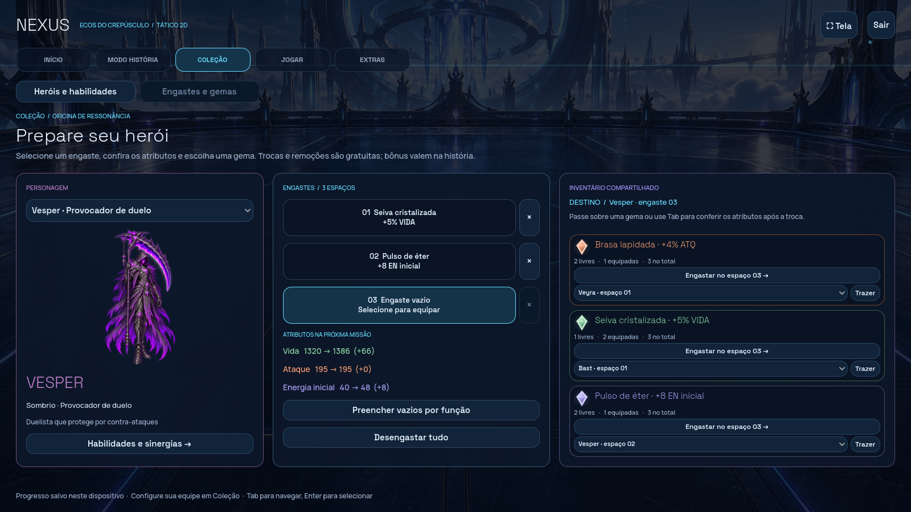

# Classes, retornos e oficina — Alpha 0.11

A batalha principal continua em 2D. Esta revisão aplica as identidades de classe, melhora habilidades antigas e reabre cinco personagens, com vinte heróis disponíveis desde a seleção. Formação, campanha, animações anteriores, efeitos modernos, automático e o estudo 3D do Vesper foram preservados.

## Identidade e sinergias

| Classe | Identidade implementada | Pontes com outras classes |
| --- | --- | --- |
| Ígneo | Queimadura e +5 pontos de chance crítica; tanques e suportes refletem 10% do dano direto à vida | Veyra detona queimadura **ou sangramento**; Exposição e fortalecimento ampliam os golpes de Torv |
| Natural | Cura, Semente, sangramento, regeneração e purificação | Sangramento prepara Noct, Riven e Maura; Semente cura o próximo atacante de qualquer classe |
| Técnico | Escudos, ataque fortalecido e defesa fortificada | Energia de Vektor antecipa técnicas e supremos; Sentinela de Axion enfraquece agressores de aliados |
| Arcano | Área, manipulação de aflições e escudos elementais; golpes consideram 75% da defesa | Ivo copia uma aflição existente; Égide de Elun e Saira reduz em 20% o dano direto com vantagem de afinidade |
| Sombrio | Drena 15% do dano direto real à vida; marcas e explosão individual | Marca obscura ou sangramento fortalece Noct e a cura de Maura; Ivo pode transportar a marca sem trocar seu autor |

As cinco afinidades mantêm o ciclo anterior. As três funções gerais continuam **Dano, Suporte e Tanque**; cada personagem também tem uma especialidade. A montagem é livre e não exige repetir classe ou função.

**Marca obscura:** 3,5% da vida máxima no início de dois turnos pessoais, atravessando escudos; seu autor vivo recupera 60% do dano periódico efetivo, respeitando sangramento, Fratura e limite de vida. Não revive nem acumula consigo mesma. Purificação a remove. Ivo copia no máximo uma aflição por técnica, mantendo duração restante e autor; não inventa aflições quando o alvo está limpo.

## Proteção com aberturas

Qualquer inimigo vivo pode ser escolhido normalmente. A posição de frente é visual; o kit determina a proteção.

- **Vesper:** Provocação e Riposta duram um turno pessoal, até o fim de sua próxima ação; a técnica custa 30 e recarrega por duas ações. Riposta responde com 30% do ataque. Área continua atingindo todos e há janelas entre as provocações.
- **Oren:** divide 25% dos golpes individuais de um aliado, com escudo e sustentação vegetal.
- **Bast:** intercepta 25% por um aliado protegido, acrescentando escudo de 18% e Fortificação. A área não é interceptada.
- **Axion:** protege com barreiras, Fortificação e Sentinela; o agressor direto fica enfraquecido depois do contato.
- **Rhazen:** Espelho e a passiva ígnea somam reflexão de 30% do dano direto à vida; devolve queimadura, sem Provocação permanente.
- **Elun:** pode colocar sua barreira, Espelho e Égide **em outro aliado**. Seu supremo converte o escudo próprio em dano e depois protege a equipe.

Um protetor só intercepta o que consegue absorver ou perder de vida: o excedente continua no alvo original. Escudos não acumulam, limitam-se a 25% da vida e expiram em duas ações do protegido. Reflexos e contra-ataques não disparam novas cadeias de reações. Se Oren ou Bast ficam sozinhos, a proteção de aliado fica indisponível e a IA continua agindo.

## Um retorno por classe

| Herói | Classe | Especialidade | Diferença central |
| --- | --- | --- | --- |
| Torv | Ígneo | Demolidor crítico | Chance crítica adicional nas técnicas; pressão sobre queimadura |
| Brin | Natural | Purificador | Cura e purificação individual frequente, com recarga de uma ação |
| Bast | Técnico | Interceptador | Defesa dirigida a um aliado e distribuição finita do golpe |
| Ivo | Arcano | Manipulador de aflições | Transmite uma aflição existente para outro adversário |
| Noct | Sombrio | Executor de marcas | Concentra dano numa presa marcada ou sangrando |

Todos têm três habilidades ilustradas, descrição, especialidade, sinergia, biografia e arte transparente. Os índices originais foram preservados; os quatro Lumi continuam arquivados. [Números completos dos vinte kits](KITS.md).

## Oficina com personagem e inventário

Abra **Coleção → Engastes e gemas**. O painel mostra o corpo do herói selecionado, três espaços independentes, atributos base e finais e o estoque compartilhado.

1. Escolha o personagem e um dos três espaços.
2. Passe sobre uma gema ou use Tab para ver os atributos após a troca. **Engastar** usa uma cópia livre e devolve a gema substituída.
3. **×** remove somente aquele espaço; **Desengastar tudo** devolve as três gemas.
4. Para redistribuir uma cópia equipada, escolha seu dono na lista da gema e clique em **Trazer**. A origem fica vazia e a cópia substituída retorna ao inventário.
5. **Preencher vazios por função** preserva espaços ocupados e outros heróis: dano prioriza ataque, tanque vida, suporte energia. Se uma preferência acabar, usa outra cópia livre.

Os três tipos e valores anteriores permanecem: ataque +4%, vida +5%, energia inicial +8. Há três cópias iniciais de cada, mais recompensas de primeiras vitórias. Trocas são gratuitas e os bônus valem somente na história. Transferências, preenchimento e remoção total salvam uma vez; falha de gravação restaura todo o inventário anterior. O progresso existente mantém o mesmo formato e caminho.

## Validar e comparar

```sh
npm run sync:godot
npm test
npm run test:godot
node scripts/simulate-classes.mjs
```

O laboratório oferece **216 partidas**: sessenta de formações variadas, noventa e seis casos de sustentação e sessenta com os cinco retornos em trios mistos e lados invertidos. Os resultados 0.11 usam arquivos próprios para preservar as estatísticas antigas.

O teste ampliado reproduz **900 partidas**, com 150 pares de trios mistos e 300 pares dirigidos aos retornos, sempre com lados invertidos e gemas desativadas. [Método e resultados desta revisão](SIMULATIONS-0.11.md). É um balanceamento inicial sujeito a testes de jogadores; as taxas pertencem à equipe e dependem dos adversários escolhidos.



[Elenco e habilidades](../docs/classes-preview/returned-roster.png) · [Trio misto](../docs/classes-preview/mixed-classes.png) · [Transmissão da marca](../docs/classes-preview/affliction-spread.png)

## Verificações da entrega

- 37 testes JavaScript de regras e invariantes.
- 29 partidas com 1.724 ações idênticas nos motores Godot e JavaScript.
- 1.273 verificações nativas gerais, além de 34 da oficina, 26 dos recibos, 51 da campanha/menus/automático, 386 do estudo 3D preservado e 33 da arte/animação de Vesper.
- Logs das 216 simulações exportadas reproduzidos integralmente no JavaScript: 14.223 ações.
- Navegação web e versão estática verificadas em desktop e celular.
- Oficina, elenco e transmissão de marca conferidos em capturas reais do Godot.
