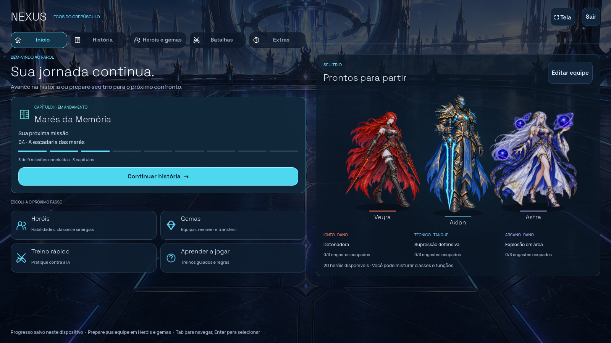

# Alpha 0.12 — menu, estados e impacto 2D

Esta revisão melhora a leitura e o peso visual do jogo. As regras permanecem na versão **0.11.0**: atributos, habilidades, engastes, campanha e resultados determinísticos continuam iguais. A proposta de progressão foi documentada separadamente, conforme a direção escolhida de equilibrar campanha/domínio com equipamentos/gemas.

## Menu inicial

A história tem uma ação principal, com capítulo, próxima missão e nove segmentos de progresso. O jogador vê primeiro o que pode continuar e tem quatro atalhos com explicação curta: Heróis, Gemas, Treino rápido e Aprender a jogar.

O painel à direita mostra os três personagens da equipe de campanha realmente salva, com especialidades e engastes ocupados. **Editar equipe** abre a formação existente. A navegação principal mantém cinco destinos: **Início, História, Heróis e gemas, Batalhas e Extras**. Treino contra IA e duelo local ficam em Batalhas; ferramentas e estudos anteriores ficam em Extras.

A ilustração da cidade ganhou espaço para aparecer e o trio ocupa a área de destaque. A imagem repetida da arena e o título grande deram lugar a informações da jornada e da equipe.



## Faixa de buffs e debuffs

Cada ficha ao lado do personagem ganhou retrato e uma faixa própria abaixo de vida, energia e escudo. Recursos e estados têm áreas independentes.

- **Verde +:** buff no personagem, como fortalecimento, regeneração, proteção ou Riposta.
- **Vermelho −:** debuff no personagem, como queimadura, sangramento, exposição ou Marca obscura.
- Cada efeito tem um **pictograma próprio** e contador de turnos. O ponto indica a última ação em que o efeito continua válido.
- Passe sobre um ícone para ler a descrição. **Clique ou use Tab e Enter** para abrir o detalhe. Efeitos excedentes têm um botão com a quantidade restante, sem serem perdidos.
- A classificação acompanha o motor: Semente e Selo astral são negativos para quem os recebe. Provocação segue a classificação positiva do kit do tanque.
- A inspeção não escolhe alvos nem consome energia. O automático espera enquanto o detalhe estiver aberto.

As fichas ficam fixas nas laterais enquanto os corpos se movem; não cobrem os medidores nem as posições de repouso dos personagens. [Faixas na batalha](../docs/polish-preview/status-hud.png) · [Detalhe de uma marca](../docs/polish-preview/status-details.png).

## Contato, área e som

Os impactos têm uma nova folha de efeitos pintados com etapas de contato, expansão, fragmentação e dissipação. As etapas são combinadas para manter a transição fluida. Fogo, água, natureza, energia e sombra têm silhuetas e materiais diferentes.

A reação do alvo começa no contato, com deslocamento, compressão e retorno. A câmera aplica um impulso localizado; o HUD permanece estável. Ataques em área têm preparação no chão e uma onda compartilhada, além do impacto individual em cada alvo. O dano continua sendo confirmado uma única vez, com os mesmos valores do motor. A prévia de crítico agora inclui o bônus de classe ígneo e o bônus próprio de cada habilidade.

As janelas de resultado ficam mais compactas em ações coletivas. Preservam dano à vida, dano ao escudo, crítico, duração e efeitos reais; o resumo conta os alvos principais e separa as reações. Ataques individuais mantêm a janela detalhada.

O áudio usa **34 clipes estéreo em 17 bancos** e mistura até oito vozes. Preparação, arma, elemento, crítico e quebra de escudo podem soar juntos. As camadas têm variação de som e afinação; o limitador controla os picos. **Som: ligado/desligado** está visível no combate e o volume fica em **Opções**. As duas preferências são salvas neste dispositivo.

**Reduzir animações** mantém os resultados e remove a coreografia, a distorção e os efeitos prolongados. Som pode ser ajustado separadamente.

[Vídeo real com som — 19 segundos](../docs/polish-preview/combat-polish.mp4).

[Contato de fogo e crítico](../docs/polish-preview/fire-contact.png) · [Fogo em área](../docs/polish-preview/area-fire.png) · [Área arcana](../docs/polish-preview/area-arcane.png) · [Restauração de água](../docs/polish-preview/water-restoration.png).

## Progressão: proposta para decidir a próxima etapa

A direção combina campanha, domínio do herói, três peças de equipamento e gemas com evolução limitada. A proposta explica recompensas previsíveis, fusão de cópias livres, variantes de habilidades e normalização de atributos no PvP futuro. **Esses sistemas novos ainda não foram implementados**; o progresso e os engastes existentes foram preservados.

Leia a [proposta de progressão](PROGRESSION.md), com alternativas concretas e pontos que precisam ser simulados antes de entrar no jogo.

## Verificação

- 37 testes de regras JavaScript.
- 196 verificações novas de ícones, inspeção, geometria do HUD, áudio, animação coletiva, cancelamento e menu.
- 29 partidas com 1.724 ações idênticas entre os motores Godot e JavaScript; replay de 216 logs exportados, com 14.223 ações.
- Suítes da campanha, oficina, recibos e estudos anteriores preservadas.
- Capturas reais no Godot, com cenários, HUD, contatos e ações coletivas.

```sh
npm test
npm run test:godot
```

Para capturar, use Godot com um renderizador gráfico e um perfil XDG isolado:

```sh
godot --path godot --script res://tests/capture_012.gd -- /tmp/nexus-preview
```
