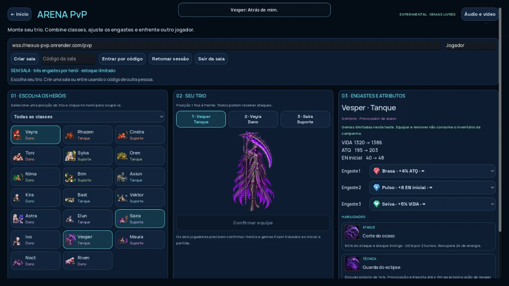
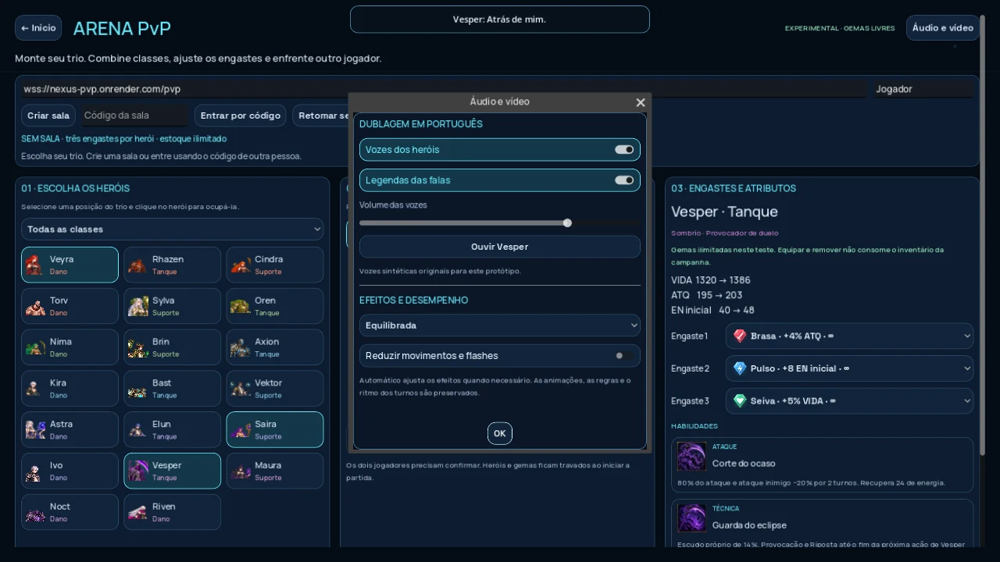
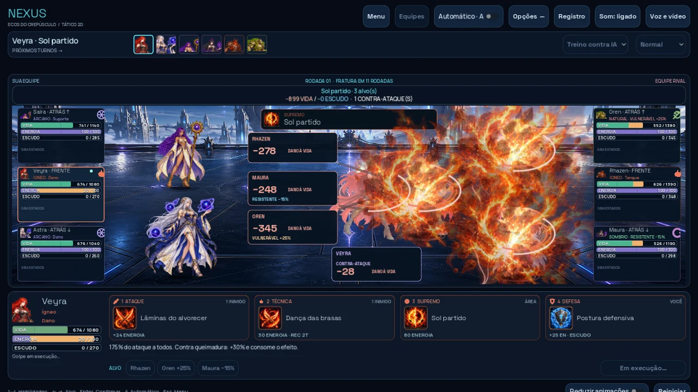
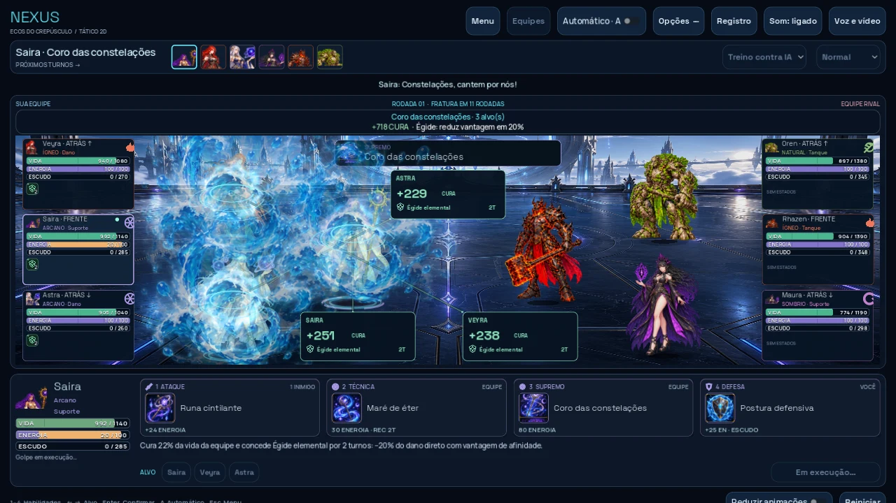
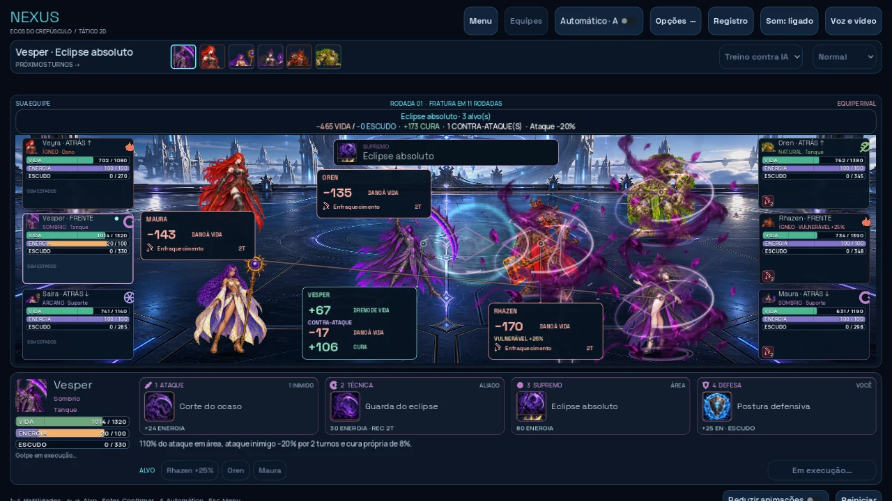

# Alpha 0.14 — Arena, vozes e apresentação 2D

O jogo usa por padrão **`wss://nexus-pvp.onrender.com/pvp`**. Perfis que guardaram `nexus-mn.onrender.com` são migrados automaticamente; sessões do endereço antigo são descartadas, sem alterar equipe, gemas ou campanha. Endereços locais/de teste continuam disponíveis.

## Arena PvP

- A função aparece abaixo do nome dos 20 heróis e nas posições do trio.
- As três habilidades têm banners com suas ilustrações próprias.
- Gemas com imagens identificáveis: vermelha para ataque, azul para energia, verde para vida. Os valores e as três posições por herói são preservados.
- Inventário PvP continua ilimitado e separado da campanha.

## Dublagem

80 gravações sintéticas em português brasileiro: seleção, técnica, supremo e vitória para cada herói ativo. São falas originais do projeto, com bases vocais, afinação, ritmo e ambiência ajustados ao personagem. Esta é uma primeira dublagem sintética para avaliação, sem atores profissionais.

Abra **Áudio e vídeo**, disponível no início, na Arena e no combate. Vozes, legendas e volume são independentes dos efeitos. Há uma faixa reservada para legendas no combate, sem sobrepor botões; os efeitos baixam durante uma fala e voltam ao volume normal quando ela termina. Cliques repetidos não disparam falas sobrepostas. As preferências persistem no dispositivo.

As gravações acrescentam aproximadamente 1,2 MiB antes dos arquivos de importação. O modelo de síntese não faz parte do jogo, e não é necessário consultar um serviço de voz durante a partida. [Créditos e roteiro](assets/voices/README.md).

## Animação e desempenho

Os 20 perfis têm preparação corporal e um motivo de contato próprio: lâminas e foice em arcos, martelo e magma em fissuras, flechas, raízes, flores, espirais, placas, drones, prismas, runas de água, fendas, fios espectrais, garras e adagas. Os efeitos são decorativos; cada ação continua aplicando um único resultado calculado pelo servidor/motor.

O custo foi reduzido com brilho em textura compartilhada, ruído pré-calculado, reutilização de ilustrações, carregamento antecipado das poses e falas dos participantes, menos efeitos redundantes por alvo e menos trabalho em telas escondidas. A distorção de tela completa fica reservada a supremos em Alta. Equilibrada e Leve mantêm impactos, cenários com partículas, recibos, movimentos e efeitos por personagem.

**Automático** começa em Equilibrada no navegador e reduz os efeitos se os quadros permanecerem lentos; também há escolhas manuais Alta, Equilibrada e Leve. Isso não altera regras, duração das fases da ação, relógio PvP ou resultados. Reduzir movimentos e flashes permanece disponível.

No teste local com Chromium/SwiftShader, quatro supremos foram medidos diretamente e dentro de um iframe simples em 1280×720. A mediana dos oito valores de p95 caiu de aproximadamente **292 ms para 158 ms**. Ambos os modos apresentavam quedas antes da alteração. Esse ambiente renderiza por software: os números são uma referência comparativa, não uma previsão de FPS no computador do jogador nem uma validação de uma chamada completa no Trono. [Amostras e limites](../docs/polish-014/performance.json).

[Vídeo real do Godot com efeitos e vozes](../docs/polish-014/preview.mp4). A gravação usa passo fixo de 30 quadros para capturar imagem e áudio; não é uma medição de FPS.

## Atualizar o itch.io e jogar pelo Trono

1. Baixe **nexus-web-0.14.zip** da branch `downloads` deste repositório.
2. No itch.io, abra **Dashboard → Nexus → Edit game** e substitua o ZIP HTML5 existente. Preserve a opção **This file will be played in the browser** e a visibilidade **Public**.
3. Salve e teste o jogo pela página pública. Confira se o campo do PvP já mostra `wss://nexus-pvp.onrender.com/pvp`.
4. Feche a janela/aba antiga do Nexus e abra novamente pelo Trono. Nenhum arquivo pesado do Nexus precisa ser enviado ao Surge.
5. Se a substituição gerar um novo ID de upload, copie o novo código **Embed game** e atualize `frontend/nexus-config.js` no Trono. Não use o endereço WebSocket como iframe.

Nenhuma alteração no balanceamento, nas fórmulas ou no formato de mensagens foi feita. O fingerprint PvP é o mesmo da Alpha 0.13; o servidor existente é compatível. Campanha, gemas, demais animações e estudo 3D de Vesper foram preservados.

## Verificação

- `npm test` e teste de integridade do elenco em `tests/voice-assets.test.js`.
- `npm run test:godot`: inclui os controles, 20 heróis × três golpes, cancelamentos, preferências, HUD e paridade do motor.
- `npm run test:pvp:godot` e `npm run test:pvp:web`: dois clientes reais e servidor autoritativo.
- `scripts/profile-presentation.mjs`: comparação no navegador.
- `godot/tests/capture_014.gd`: capturas reais dos 20 supremos; `scripts/art/build-voices.py`: geração das gravações.

Para exportar novamente: Godot **4.6.3** com os modelos Web da mesma versão e `npm run build:game`. A exportação agora já usa o servidor público correto; `PVP_PUBLIC_URL` continua permitindo um servidor de teste.
