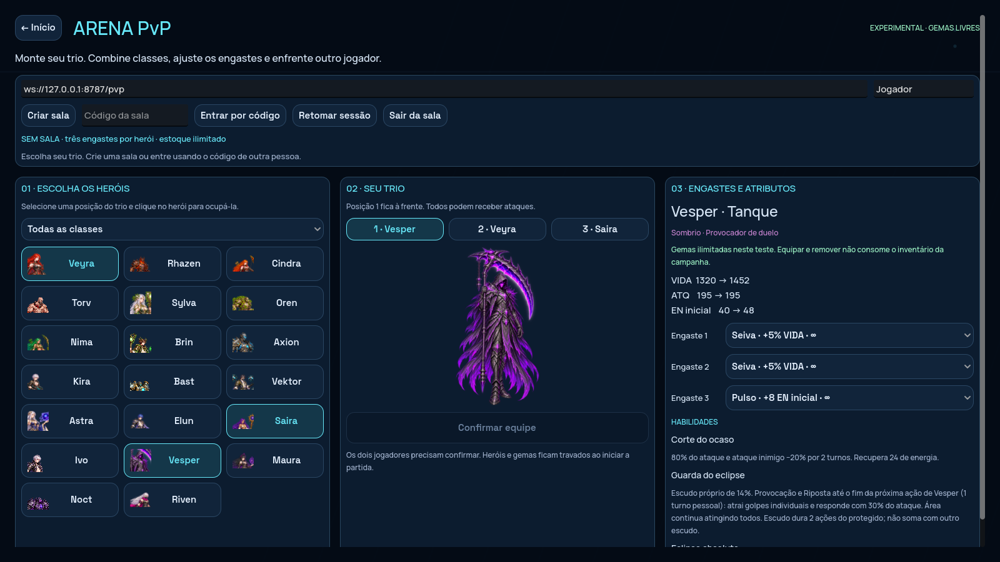

# Alpha 0.13 — PvP experimental e integração

O PvP online já está implementado para **duas pessoas por sala**, com convidados por código. O jogo e o servidor precisam ser publicados separadamente. Este repositório não cria contas no itch.io, Render ou Supabase, nem publica nesses serviços automaticamente.



[Partida online na exportação Web, capturada no navegador](../docs/pvp-preview/online.png).

## O que está pronto

- **Batalhas → Preparar equipe PvP:** tela própria com os 20 heróis, filtro de classe, três posições, habilidades e engastes ao lado.
- **Estoque ilimitado das três gemas atuais**, com três engastes por herói, inclusive repetição. Atributos base e resultado com as gemas aparecem juntos. Não há novos tipos de gema ou níveis nesta etapa.
- Formação PvP salva em `user://pvp-loadout.json`. Não usa nem consome a campanha.
- Salas por código, confirmação dos dois participantes, bloqueio da formação e distribuição aleatória dos lados para não favorecer sempre o anfitrião nos desempates de velocidade.
- Servidor WebSocket autoritativo: valida versão, turno, habilidade, alvo, energia e engastes. O cliente recebe os resultados calculados pelo servidor e os apresenta com as animações e sons existentes.
- 90 segundos por turno. Perda de conexão pausa o relógio enquanto há até 60 segundos para reconectar. Inspecionar habilidades/estados não pausa o relógio online. Tempo e desistência têm resultados próprios.
- Reconexão automática e botão **Retomar sessão** após recarregar, no mesmo dispositivo e servidor. A senha da sessão não entra nos registros de partidas.
- Registros PvP separados de campanha e simulações; painel administrativo com filtros e download do replay completo.

## 1. Jogar agora no computador, antes de publicar

Instale **Node.js 24** e **Godot Standard 4.6.3**. Baixe a branch `codex/nexus-2d` e abra o terminal na raiz do repositório:

```sh
npm ci
npm run pvp:server
```

Deixe esse terminal aberto. O servidor ficará em `ws://127.0.0.1:8787/pvp`. Abra `godot/project.godot` no Godot e execute o projeto completo com **F5**.

Em **Batalhas → Preparar equipe PvP**:

1. Confira o endereço do servidor e escreva seu nome.
2. Selecione uma posição do trio e clique no herói que deve ocupá-la. Escolher um herói já selecionado troca as posições.
3. Use os três seletores à direita para equipar ou remover gemas. As cópias são livres neste teste.
4. Clique em **Criar sala** e copie o código exibido.
5. No segundo cliente, escolha o trio e use **Entrar por código**.
6. Ambos clicam em **Confirmar equipe**. A partida começa automaticamente.
7. Cada pessoa controla somente seu lado, identificado acima da arena. Ao terminar, volte à preparação para uma nova partida.

Para dois computadores na mesma rede, execute o servidor em um deles e, nos dois jogos nativos, use `ws://IP-DO-COMPUTADOR:8787/pvp`. Libere a porta no firewall desse computador. `127.0.0.1` sempre aponta para o próprio dispositivo. Para pessoas em redes diferentes, publique o servidor conforme a seção 3.

### Testar a versão de navegador localmente

No Godot, instale os **modelos de exportação da mesma versão** pelo menu **Editor → Gerenciar modelos de exportação**. Em outro terminal:

```sh
npm run build:game
npm run serve:game
```

Abra `http://localhost:8080`. O pacote para distribuição será `artifacts/nexus-web.zip`. A primeira exportação desta versão ficou em aproximadamente **86 MiB compactados / 115 MiB de arquivos web**. O tamanho pode mudar nas próximas exportações.

Para testar dois convidados no mesmo computador, use duas sessões de navegador independentes, por exemplo um perfil normal e uma janela anônima. Isso também separa as credenciais de reconexão. O endereço `http://localhost:8080/?pvp=1` abre diretamente a preparação PvP.

## 2. Criar o armazenamento dos registros no Supabase

1. Crie um projeto em [supabase.com](https://supabase.com).
2. Abra o **SQL Editor** e execute [server/supabase.sql](../server/supabase.sql).
3. Nas configurações de API, copie a **Project URL** e a chave de servidor **service_role**.
4. Guarde essas duas informações para configurar o Render. **A chave de servidor fica somente no backend**, nunca no Godot, HTML, Surge ou código público.

A tabela tem RLS habilitado, sem acesso para usuários anônimos ou autenticados comuns. O backend grava um registro por partida, contendo versão, semente, trios, gemas, atributos, ações, eventos e resultado.

Localmente, os registros ficam em `artifacts/pvp-data/matches.ndjson`. No Render gratuito, o disco é temporário; configure o Supabase para preservar os registros entre publicações. Se o banco ficar indisponível, o servidor mantém uma cópia local e tenta reenviar a cada 30 segundos. Uma reinicialização durante essa indisponibilidade pode perder os envios pendentes no disco temporário.

## 3. Publicar o servidor no Render

1. Entre em [render.com](https://render.com) e conecte o GitHub.
2. Escolha **New → Blueprint**, selecione este repositório e a branch **codex/nexus-2d**. O arquivo [render.yaml](../render.yaml) define o serviço.
3. O modelo usa o plano **Free** para testes. Revise as opções exibidas pelo Render antes de criar. Esse plano pode suspender o serviço quando ocioso; para disponibilidade contínua, escolha um plano apropriado.
4. Preencha as variáveis solicitadas:

| Variável | Valor |
| --- | --- |
| `SUPABASE_URL` | Project URL do Supabase |
| `SUPABASE_SERVICE_ROLE_KEY` | Chave de servidor service_role |
| `PVP_ALLOWED_ORIGINS` | `https://html-classic.itch.zone,https://itch.io` inicialmente; ajuste para a origem real do iframe, se diferente |
| `PVP_ADMIN_TOKEN` | Gerada pelo Blueprint; mantenha em segredo e copie para consultar o painel |

O Blueprint configura Node 24, `npm ci --omit=dev`, `npm run pvp:server` e verificação em `/health`. Se criar um **Web Service** manualmente, use esses mesmos valores e crie uma chave administrativa aleatória com pelo menos 24 caracteres.

5. Aguarde a publicação e abra `https://NOME-DO-SERVICO.onrender.com/health`. A resposta deve mostrar `"ok": true`.
6. O endereço das partidas será **`wss://NOME-DO-SERVICO.onrender.com/pvp`**.

Use **uma única instância** do servidor nesta etapa: as salas ativas ficam na memória desse processo. Reiniciar ou publicar uma nova versão encerra as salas em andamento. Os registros já enviados ao Supabase permanecem.

`PVP_ALLOWED_ORIGINS` aceita origens completas, separadas por vírgulas, sem caminho ou barra final. No itch.io, a conexão normalmente parte de `https://html-classic.itch.zone`, onde roda o jogo, e não da página externa do autor. Se houver rejeição HTTP 403 no WebSocket, confira a origem real no navegador e acrescente somente a origem correta. Clientes nativos não enviam esse cabeçalho e continuam permitidos.

## 4. Exportar com o endereço público e enviar ao itch.io

Na raiz do projeto, gere o pacote com o servidor público configurado:

**macOS/Linux:**

```sh
PVP_PUBLIC_URL=wss://NOME-DO-SERVICO.onrender.com/pvp npm run build:game
```

**PowerShell:**

```powershell
$env:PVP_PUBLIC_URL="wss://NOME-DO-SERVICO.onrender.com/pvp"
npm run build:game
```

Se `godot` não estiver no PATH, defina `GODOT_EXECUTABLE` com o caminho completo do executável. A exportação usa o preset **Web**, sem threads, e inclui os JSONs necessários. O script cria **`artifacts/nexus-web.zip`**, com `index.html` na raiz. O comando `npm run build` existente continua sendo o protótipo JavaScript; para esta versão Godot, use **`npm run build:game`**.

1. No [itch.io](https://itch.io), crie um projeto e selecione **Kind of project: HTML**.
2. Envie `artifacts/nexus-web.zip` e marque o arquivo para ser executado no navegador.
3. Configure uma área de pelo menos **1280×720**, opção de tela cheia e execução por clique.
4. Salve e teste a página do jogo. Confira no campo Servidor PvP se aparece o endereço `wss://` publicado.
5. Teste com duas pessoas: criar sala, entrar por código, confirmar e concluir uma partida.
6. Em **Distribute → Embed game** (ou a opção de incorporação exibida pelo itch.io), copie o iframe fornecido. Use o iframe do jogo, não o widget de compra/download.

Em páginas HTTPS, use `wss://`; o navegador bloqueia `ws://` público. Caso use o ZIP já gerado para testes locais, você também pode preencher manualmente o endereço público na preparação PvP, mas exportar com `PVP_PUBLIC_URL` evita que cada jogador precise configurá-lo.

## 5. Integrar ao A Lei do Trono no Surge

O arquivo [web/lei-do-trono-embed.html](../web/lei-do-trono-embed.html) é um exemplo pronto de página leve com botão de carregamento, incorporação, tela cheia e abertura em outra página.

1. Copie o exemplo para o projeto A Lei do Trono ou adapte seu conteúdo para a rota de jogos do frontend.
2. Troque **somente `GAME_EMBED_URL`** pelo endereço `src` do iframe fornecido pelo itch.io.
3. Adicione um item **Jogos → Nexus** no menu do site/app.
4. Publique apenas o frontend normal no Surge. **Não copie a pasta `artifacts/web-game`, o ZIP, os modelos de exportação ou os arquivos Godot para o diretório de publicação do site.**
5. Teste o botão Jogar. Ele cria o iframe somente depois do clique; o jogo será baixado do itch.io quando aberto.

O código do A Lei do Trono não está neste workspace, então esta entrega fornece o componente de integração; não altera o site ou app existente. No app, valide WebView, áudio e tela cheia. A primeira validação é para navegadores de computador; em telas pequenas, use orientação horizontal e mantenha a abertura externa disponível. Login único com o A Lei do Trono ainda não foi integrado: nesta etapa os participantes usam apelidos de convidados.

## 6. Consultar o balanceamento

Abra **`https://NOME-DO-SERVICO.onrender.com/admin`** e informe a chave `PVP_ADMIN_TOKEN` do Render. A chave não é salva pelo painel.

- Filtre por ID do herói, gema, versão das regras e motivo do encerramento.
- Confira participações, vitórias, dano, cura e escudo.
- Clique no identificador da partida para baixar o registro completo, incluindo configurações e ações.
- Baixe o resumo JSON para análise externa.

Para conferir um replay baixado com a mesma revisão do código:

```sh
node scripts/replay-pvp.mjs CAMINHO-DO-REGISTRO.json
```

O painel consulta as **100 partidas recentes** carregadas pelo servidor. O arquivo local e a tabela Supabase mantêm o histórico completo; consulte o banco para estudos maiores. A taxa de vitória considera somente partidas encerradas por combate. Desistências, desconexões e tempo esgotado ficam separados. Dano/cura/escudo são totais do conjunto filtrado, não médias ajustadas pela duração. Heróis podem aparecer dos dois lados; compare também os trios e as gemas antes de concluir que um kit está forte.

## Regras, limites e manutenção

- Sem ranking, matchmaking público, chat, espectadores, contas ou recompensas nesta primeira etapa.
- As regras base continuam **0.11.0**; os engastes experimentais têm versão própria **pvp-test-1**.
- Alterou kits, fórmulas ou gemas? Execute `npm run sync:godot`, valide, publique o servidor e exporte novamente o jogo. Builds incompatíveis são recusadas antes de entrar na sala.
- A chave administrativa e a chave Supabase nunca são distribuídas no pacote web.
- A publicação externa exige suas contas nos três serviços. O repositório traz configuração e scripts, não um endereço público já provisionado.

## Verificação reproduzível

```sh
npm test
npm run test:pvp
npm run test:pvp:godot
npm run test:godot
npm run build:game
npm run test:pvp:web
```

O teste web requer Chromium (ou `CHROMIUM_EXECUTABLE_PATH`) e a exportação pronta.

O teste de integração sobe um servidor WebSocket real, conecta dois clientes Godot, equipa gemas, confirma as formações, conclui uma partida, compara os resultados e confere o registro persistido. Os testes do servidor também cobrem controle indevido do adversário, alvo ilegal, ação repetida, versões incompatíveis, reconexão, expiração, administração e reenvio de registros.

Nesta entrega passaram os **44 testes Node**, as suítes Godot existentes, uma partida completa entre dois clientes Godot com reconexão e a criação de sala/entrada/confirmação/ação entre dois navegadores. O replay de uma partida de 64 ações também foi reproduzido com gemas e resultados idênticos.
