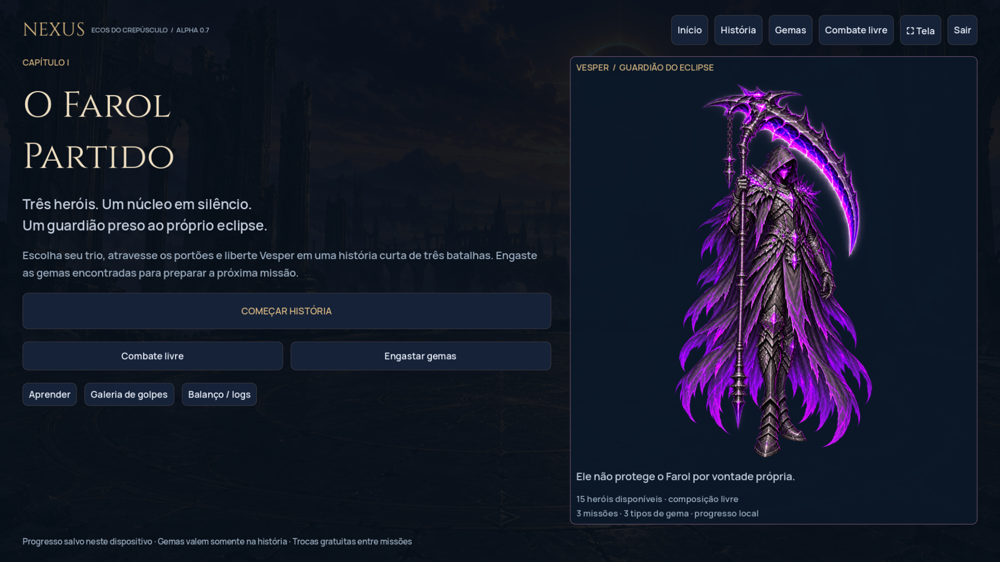

# NEXUS em Godot — Alpha 0.7

Godot 4.6 Standard / GDScript, gratuito e sem addons pagos. Validado com Godot 4.6.3 em Linux.

## Atualizar e abrir no Windows

1. Feche o Godot. Abra a [branch atualizada](https://github.com/JonathaPereira/PROJETO-NEXUS/tree/codex/nexus-jogavel).
2. Clique em **Code → Download ZIP** e depois **Extrair tudo**, em uma pasta nova.
3. No gerenciador do Godot, clique em **Importar** e selecione `godot/project.godot` dentro da pasta extraída.
4. Aguarde a importação, pressione **F5** e confira **ALPHA 0.7** no menu inicial.
5. Clique em **Começar história → Jogar missão → Iniciar missão**. Em **Engastar gemas**, prepare seu trio; **Combate livre** mantém os modos anteriores.

Sua cópia anterior não atualiza automaticamente. Quem usa Git pode atualizar a branch com `git pull --ff-only`, preservando alterações locais.

## Menu, história e gemas

O menu inicial abre **História**, **Gemas**, **Combate livre**, os treinos **Aprender**, a galeria e o laboratório. **Menu**, durante uma luta, permite voltar; uma confirmação evita descartar a batalha por engano. Batalhas em andamento não são salvas.

**O Farol Partido** é um capítulo curto de três missões. Sentinela de Cacos, Rastejante de Raiz e Acólito do Véu têm artes, atributos e habilidades de minions; a última missão enfrenta **Vesper como chefe**, com dois servos. O chefe tem atributos próprios, preservando o Vesper selecionável. Há introdução, dica tática e desfecho em cada missão, desbloqueio sequencial e final do capítulo. A equipe de história é independente dos dois trios do combate livre; escolha qualquer composição de três heróis distintos. Vida e energia são restauradas a cada missão.

Cada herói tem **um engaste**. Você começa com uma cópia de cada gema: **Brasa lapidada (+4% ATQ)**, **Seiva cristalizada (+5% VIDA)** e **Pulso de éter (+8 energia inicial)**. Equipar, trocar e remover é gratuito, entre missões; uma cópia só pode estar em um herói por vez. Cada primeira vitória concede mais uma gema: Brasa na missão 1, Seiva na 2 e Pulso na 3. Repetir missões não repete recompensas. O painel mostra estoque livre, donos das cópias e atributos antes/depois.

**Gemas valem somente na história.** Combate livre, duelo local, treinos, galeria e laboratório preservam as regras e os atributos de referência da Alpha 0.5. Partidas de campanha não entram na tabela de balanço. Progresso, trio e engastes são salvos automaticamente em `user://campaign-0.7.json`, no diretório de dados do Godot deste jogo. Não há conta nem sincronização entre dispositivos. [Regras e missões da campanha](CAMPAIGN.md).



[Missões](preview/story.png) · [Engastes](preview/gems.png) · [Minions](preview/minions.png)

## Cinco afinidades, três funções por classe

O ciclo é **Ígneo → Natural → Técnico → Arcano → Sombrio → Ígneo**. Vantagem: +25%; resistência na direção inversa: −15%; demais relações neutras. Classe define afinidade, enquanto tanque, suporte e dano são funções do kit. Você pode combinar livremente três personagens distintos, sem obrigação de levar um de cada função.

Há **15 personagens ativos**. Lumi e nove personagens ficam arquivados, preservando dados, imagens e índices de atlas. Preferências antigas com personagens inativos usam a equipe padrão ao importar a nova versão. [Kits e sinergias](KITS.md).

| Classe | Tanque | Suporte | Dano |
| --- | --- | --- | --- |
| Ígneo | Rhazen | Cindra | Veyra |
| Natural | Oren | Sylva | Nima |
| Técnico | Axion | Vektor | Kira |
| Arcano | Elun | Saira | Astra |
| Sombrio | Vesper | Maura | Riven |

## Leitura do combate

Escolha habilidade, alvo e **Usar em…**. **1–4**, setas e **Enter** também funcionam. Ataques recuperam 24 de energia; defesa recupera 25, concede escudo e reduz dano até o próximo turno; técnica custa 30 e tem dois turnos pessoais de recarga; supremo custa 80, com alcance próprio de cada kit.

O banner mostra a **prévia normal e crítica**, separando dano à vida e ao escudo. Passe o mouse para ver os recibos por alvo, reações e estados. A prévia não altera energia, turnos ou aleatoriedade e exclui os efeitos do início do próximo turno. Críticos têm 10% de chance e +40% de dano. Ao executar, a prévia dá lugar ao resultado real; selecionar outra ação ou alvo volta a mostrar a previsão.

Vida é verde; escudo, azul; energia, violeta. Os valores distinguem dano absorvido, escudo restante e quebra. Combo, contra-ataque, protetor e cura da Semente têm identificação própria. **Registro** conserva os detalhes. Estados mostram duração e explicação no tooltip; muitos estados aparecem como `+N estados` para caber na ficha.

Queimadura e sangramento causam 6,5% da vida máxima em dois inícios de turno, ignorando escudos; regeneração cura 4%. **Sangramento também reduz toda cura recebida em 35%**, inclusive regeneração, Semente, dreno e curas secundárias. Purificação remove efeitos negativos. Uma habilidade que cura e purifica aplica a cura antes da limpeza; a prévia mostra o valor já reduzido. Aplicar novamente renova a duração sem duplicar. Provocação limita ataques individuais, mas não ataques em área. Proteção de Oren desvia 25% de um ataque individual para ele enquanto estiver vivo; escolher o próprio Oren concede escudo, sem desvio para si.

**Fratura** começa na rodada 12: dano direto de 4% da vida máxima antes de cada ação pessoal, aumentando 2,5 pontos percentuais por rodada, até 85%. Ignora escudos. Também reduz **toda cura recebida em 10 pontos percentuais por rodada**: −10% na rodada 12, −20% na 13, até −100% na 21. Essa redução não pode ser purificada e multiplica a redução do sangramento. O HUD mostra dano e redução de cura atuais; prévia, números flutuantes e registro explicam curas reduzidas. É uma garantia contra impasses, sem obrigar funções na montagem da equipe.

## Tela cheia e Full HD

Abra **Tela** e escolha **Tela cheia Full HD 1920×1080**, depois **Aplicar**. **F11** alterna entre janela e tela cheia; **Esc** volta à janela quando não há um painel aberto. Há opções de janela 1280×720, 1600×900 e 1920×1080. O desenho usa base 1600×900 e acompanha o tamanho da tela, preservando a disposição. O modo efetivo de tela cheia segue as resoluções suportadas pelo monitor e pelo sistema. Preferências de tela ficam salvas junto das equipes. Se o jogo estiver embutido no editor, execute-o em uma janela separada para ocupar o monitor inteiro.

## Sinergias para experimentar

- **Rhazen + Cindra + Veyra:** Rhazen provoca e devolve queimadura; Cindra também prepara brasas. Veyra consome o efeito para amplificar a técnica. Como Veyra costuma agir antes de Cindra, a preparação normalmente vem da rodada anterior.
- **Axion + Vektor + Kira:** Axion e Vektor expõem a defesa; Vektor fornece energia a Kira. Sua técnica recebe bônus contra exposição, e seus disparos atravessam parte do escudo.
- **Oren + Maura + Riven:** Riven abre sangramento, reduzindo a cura recebida pelo inimigo. Maura aproveita a ferida para curar mais o aliado com menor porcentagem de vida; Oren protege esse aliado. Riven pode finalizar alvos abaixo de 35% da vida.
- **Nima + Vektor + Kira:** dois personagens de dano e um suporte, sem tanque. Sangramento atrapalha a cura adversária; exposição prepara os disparos de Kira, e Vektor entrega energia ou purifica. O trio abre mão de Provocação e proteção para pressionar um alvo.
- **Elun + Sylva + Astra:** Elun expõe a defesa e converte seu escudo em dano; Sylva semeia recuperação para quem atacar; Astra marca o próximo golpe e amplia seu supremo contra exposição.

Estas são combinações para testar, sem garantia de vitória. [Kits completos](KITS.md) detalham condições, custo e duração.

## Treinos e laboratório

**Aprender** oferece três batalhas com objetivos acompanhados no HUD: turnos/energia/defesa, afinidade/combo e escudos/dano contínuo. Os trios são fixos nesse modo; ao sair pelo botão **Voltar ao treino livre**, as equipes e opções anteriores voltam. Os treinos não entram nas estatísticas de partidas jogadas e são separados da nova campanha.

**Balanço** mostra aparições e vitórias por herói, dano direto à vida, dano a escudos, cura direta, proteção efetiva, energia e combos. Danos e curas periódicos ainda não entram nos totais individuais. A duração média e a frequência da Fratura ajudam a identificar combates arrastados. Escudo concedido sem ser consumido não conta como proteção útil; a absorção é atribuída ao dono do escudo, e o dano à vida desviado, ao protetor.

As partidas jogadas ficam separadas das **simulações IA × IA**. O botão simula **156 partidas** com sementes fixas. O filtro **formações variadas** mantém 60 partidas com três funções, classes únicas e mistas, em pares espelhados. O filtro **testes de sustentação** separa outras 96: Vesper/Kira/Oren, Saira/Maura/Sylva, trios de suporte, trios de tanque e espelhos que priorizam cura e substituem ataques sem cura por defesa. Assim, a amostra defensiva não distorce as médias da amostra variada. As amostras são limitadas e dependem de composição, dificuldade e decisões; a taxa de vitória não comprova equilíbrio competitivo. Guarda até 500 partidas em `user://balance-0.5.json`; apagar esse arquivo reinicia o histórico. As regras e o TTK da Alpha 0.5 foram preservados; suas estatísticas continuam no mesmo arquivo. O histórico da Alpha 0.4 permanece no arquivo anterior. Equipes e preferências ficam em `user://preferences.cfg`. Batalhas em andamento não são salvas.

## Exportar simulações

1. Abra **Balanço** e clique em **Simular 156 partidas**.
2. Escolha **formações variadas** ou **testes de sustentação**.
3. Clique em **Exportar logs JSON**, escolha a pasta e salve. O painel mostra o caminho salvo.
4. Use **Exportar tabela CSV** para abrir os resultados em uma planilha. O CSV usa UTF-8, separador `;` e vírgula decimal.

O JSON é formatado com quebras de linha e inclui versão das regras, filtro, sementes, equipes, estado inicial, alvo e recibos de cada ação, efeitos do próximo turno, vida/energia/escudo/estados após cada ação, vencedor e estatísticas finais. O log completo é do **último lote simulado**, no filtro escolhido. O mesmo arquivo também traz os resumos históricos que compõem a tabela visível. Partidas antigas têm somente resumo; não inventamos ações que não foram armazenadas.

O último lote fica salvo em `user://simulations-0.6.json` e continua exportável depois de fechar o jogo. Simular outro lote substitui esse log detalhado, preservando o histórico compacto até seu limite de 500 partidas. Os JSONs exportados em outra pasta permanecem disponíveis.

A coluna de vitórias agora exibe **vitórias/aparições e porcentagem**; amostras menores que 30 aparições recebem destaque. Os testes dirigidos podem produzir extremos como 100% porque repetem adversários específicos. Compare composição, adversário e N antes de concluir que um tanque está forte ou fraco.

## Apresentação preservada e refinada

O chão é reenquadrado pela borda inferior para aparecer sob todos os pés. Silhuetas ficam ancoradas ao chão, com sombras de contato; a distância altera escala e altura. É uma apresentação 2.5D com artes em perspectiva, sem modelos 3D. A referência de disposição é o Marvel Avengers Alliance: **um personagem mais próximo do adversário, no centro, e dois atrás, um acima e outro abaixo**. As fichas acompanham cada integrante, com **VIDA**, **ENERGIA** e **ESCUDO** em barras independentes, valores exatos e duração do escudo. O trio padrão novo leva Axion à frente; equipes já salvas são preservadas. Em **Equipes**, use o seletor **Personagem na FRENTE** para ordenar seu trio sem remover integrantes.

**Ataque básico acerta somente UM alvo escolhido**, que pode estar na frente ou atrás. A posição, por si só, não bloqueia ataques nem reduz dano. **Provocação** de Rhazen/Vesper restringe golpes individuais ao provocador enquanto estiver ativa; ataques em área continuam atingindo todos os rivais vivos. Esses avisos aparecem ao selecionar uma ação.

**Escudos não somam e não são permanentes.** Mantém-se o valor maior, limitado a 25% da vida máxima, por duas ações seguintes do protegido. Um escudo menor não renova um maior ainda válido. Um escudo que já chegou à última ação pode ser substituído pelo novo valor; a defesa comum fornece 6%. Expiração, absorção e quebra têm recibos distintos. Oren protege um aliado com desvio de 25%; o dreno Sombrio passou a 15%, e a regeneração, a 4% por ativação. Na Alpha 0.5, cura, escudos e atributos dos kits foram revistos; veja a [comparação das simulações](BALANCE.md). Os dez ativos que dependiam do atlas antigo receberam recortes novos em três folhas com células separadas, preservando as identidades. O atlas anterior continua arquivado. Os 15 ativos usam 45 imagens de habilidades, mantendo os atlas completos de 72 imagens. Cinco representantes ativos (Veyra, Sylva, Axion, Astra e Vesper) têm quatro poses desenhadas; os outros dez usam uma ilustração com movimento procedural. As artes de Auren e dos demais arquivados continuam disponíveis no projeto.

Supremos combinam texturas pintadas com brilho aditivo e distorção animada, junto de uma sequência visual própria: preparação com sigilo no chão, partículas convergentes, condução até os alvos e impacto prolongado. Ígneo usa chuva de brasas e fissuras; Natural, raízes e folhas; Técnico, feixes orbitais e campos hexagonais; Arcano, constelações e portais; Sombrio, eclipse e vórtices. Curas e proteção usam auras restauradoras. Os efeitos respeitam **Reduzir animações** e não alteram dano, recargas ou TTK.

Cada um dos 15 personagens tem coreografia identificada por seu golpe, com preparação, disparo ou avanço, contato, reação e retorno. Há saltos de martelo, cortes duplos, flechas, trilhos de energia, drones, prismas, runas, órbitas e fios. A derrota tem reação própria. As cinco artes com poses e os dez movimentos sobre ilustração continuam distintos: esta atualização não adiciona animação esquelética aos dez restantes. Suportes não avançam sobre o inimigo ao conjurar; escudo e crítico possuem sons próprios. A opção **Reduzir animações** mantém as regras e remove a coreografia.

**Golpes** abre a galeria isolada com seletor para **todos os 15 personagens** e cinco atalhos de classe. Há cenários normal, escudo com crítico demonstrativo e queimadura/sangramento. A técnica de Veyra consome a queimadura para seu combo; use o ataque básico nesse cenário para observar os dois efeitos contínuos. A galeria calcula ações somente para o par exibido, evitando dreno ou cura derivados de figurantes invisíveis. Passe o mouse sobre o resultado para ler todos os recibos. A galeria não altera a partida.


[Artes dos 15](preview/roster-art.png) · [Supremo](preview/ultimate.png) · [Escolher a frente](preview/formation.png) · [Galeria](preview/gallery.png) · [Crítico em escudo](preview/shield-critical.png) · [Estados](preview/debuffs.png) · [Cura reduzida](preview/healing.png) · [Laboratório](preview/balance.png) · [Testes de sustentação](preview/balance-stress.png) · [Treino guiado](preview/lesson.png)

## Código e validação

`src/kits.js` define os kits originais; `npm run sync:godot` sincroniza o catálogo, sem sobrescrever os recortes e poses refinados. `scripts/combat.gd` implementa as regras nativas; `main.gd` controla o fluxo; `combat_ui.gd` apresenta HUD e prévias; `campaign.gd` define missões, inimigos, gemas e salvamento; `hub.gd` apresenta menu, missões e engastes; `lessons.gd` define os objetivos; `lab.gd` agrega e simula partidas. A engine JavaScript serve como referência de paridade do combate livre e continua sustentando o protótipo web.

Na raiz do repositório:

```bash
npm test
npm run test:godot
npm run test:browser
npm run test:site
node scripts/balance-report.mjs
```

Godot deve estar no PATH (ou `GODOT_EXECUTABLE`). Os testes verificam kits, sinergias, recursos, estados, término de partidas, paridade entre os motores e interface nativa. Também exportam os dois filtros e reproduzem todas as ações dos JSONs no motor JavaScript, conferindo recibos e estados; verificam o CSV, caminhos de salvamento e erros de destino. Artefatos e preferências de teste ficam isolados em `artifacts/`.

A campanha tem verificações de três missões completas, bloqueios, chefe, primeira vitória e repetição sem duplicar recompensas, derrota e nova tentativa, estoque e troca de gemas, reabertura do progresso, dados inválidos e falha de gravação. Os testes confirmam que o modo história preserva os trios livres e não altera os atributos nem as estatísticas do laboratório.

A versão Godot é aberta no editor nesta etapa. **GitHub Pages continua com o protótipo web anterior**; exportar Godot para navegador será outra entrega. A primeira campanha e os engastes estão implementados; treinamento de skills, obtenção de heróis, multiplayer online e integração com A Lei do Trono permanecem no [roteiro de progressão](ROADMAP.md).
