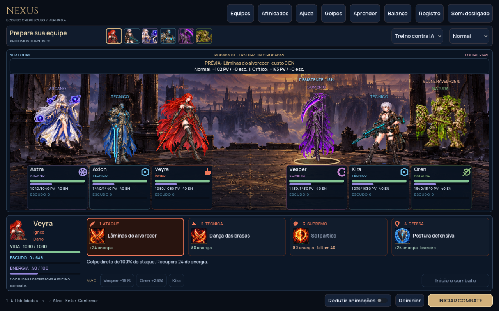

# NEXUS em Godot — Alpha 0.4

Godot 4.6 Standard / GDScript, gratuito e sem addons pagos. Validado com Godot 4.6.3 em Linux.

## Atualizar e abrir no Windows

1. Feche o Godot. Abra a [branch atualizada](https://github.com/JonathaPereira/PROJETO-NEXUS/tree/codex/nexus-jogavel).
2. Clique em **Code → Download ZIP** e depois **Extrair tudo**, em uma pasta nova.
3. No gerenciador do Godot, clique em **Importar** e selecione `godot/project.godot` dentro da pasta extraída.
4. Aguarde a importação, pressione **F5** e confira **ALPHA 0.4** no topo.
5. Experimente **Aprender** para os três treinos guiados, ou **Equipes → Iniciar combate** para jogar livremente.

Sua cópia anterior não atualiza automaticamente. Quem usa Git pode atualizar a branch com `git pull --ff-only`, preservando alterações locais.

## Cinco afinidades, três funções por classe

O ciclo é **Ígneo → Natural → Técnico → Arcano → Sombrio → Ígneo**. Vantagem: +25%; resistência na direção inversa: −15%; demais relações neutras. Classe define afinidade, enquanto tanque, suporte e dano são funções do kit. Você pode combinar livremente três personagens distintos, sem obrigação de levar um de cada função.

Há **15 personagens ativos**. Lumi e nove personagens ficam arquivados, preservando dados, imagens e índices de atlas. Preferências antigas com personagens inativos usam a equipe padrão ao importar a nova versão. [Kits e sinergias](KITS.md).

| Classe | Tanque | Suporte | Dano |
| --- | --- | --- | --- |
| Ígneo | Rhazen | Cindra | Veyra |
| Natural | Oren | Sylva | Nima |
| Técnico | Axion | Vektor | Kira |
| Arcano | Elun | Saira | Astra |
| Sombrio | Vesper | Maura | Riven |

## Leitura do combate

Escolha habilidade, alvo e **Usar em…**. **1–4**, setas e **Enter** também funcionam. Ataques recuperam 24 de energia; defesa recupera 25, concede escudo e reduz dano até o próximo turno; técnica custa 30 e tem dois turnos pessoais de recarga; supremo custa 80, com alcance próprio de cada kit.

O banner mostra a **prévia normal e crítica**, separando dano à vida e ao escudo. Passe o mouse para ver os recibos por alvo, reações e estados. A prévia não altera energia, turnos ou aleatoriedade e exclui os efeitos do início do próximo turno. Críticos têm 10% de chance e +40% de dano. Ao executar, a prévia dá lugar ao resultado real; selecionar outra ação ou alvo volta a mostrar a previsão.

Vida é verde; escudo, azul; energia, violeta. Os valores distinguem dano absorvido, escudo restante e quebra. Combo, contra-ataque, protetor e cura da Semente têm identificação própria. **Registro** conserva os detalhes. Estados mostram duração e explicação no tooltip; muitos estados aparecem como `+N estados` para caber na ficha.

Queimadura e sangramento causam 6,5% da vida máxima em dois inícios de turno, ignorando escudos; regeneração cura 7%. Purificação remove efeitos negativos. Aplicar novamente renova a duração sem duplicar. Provocação limita ataques individuais, mas não ataques em área. Proteção de Oren desvia 35% de um ataque individual para ele enquanto estiver vivo; escolher o próprio Oren concede escudo, sem desvio para si.

**Fratura** começa na rodada 12: dano direto de 4% da vida máxima antes de cada ação pessoal, aumentando 2,5 pontos percentuais por rodada, até 85%. Ignora escudos e encerra impasses. O HUD mostra a contagem e depois a porcentagem atual, e cada ocorrência fica no registro.

## Treinos e laboratório

**Aprender** oferece três batalhas com objetivos acompanhados no HUD: turnos/energia/defesa, afinidade/combo e escudos/dano contínuo. Os trios são fixos nesse modo; ao sair pelo botão **Voltar ao treino livre**, as equipes e opções anteriores voltam. Os treinos não entram nas estatísticas de partidas jogadas. São introduções às regras, ainda sem campanha ou progressão.

**Balanço** mostra aparições e vitórias por herói, dano direto à vida, dano a escudos, cura direta, proteção efetiva, energia e combos. Danos e curas periódicos ainda não entram nos totais individuais. A duração média e a frequência da Fratura ajudam a identificar combates arrastados. Escudo concedido sem ser consumido não conta como proteção útil; a absorção é atribuída ao dono do escudo, e o dano à vida desviado, ao protetor.

As partidas jogadas ficam separadas das **simulações IA × IA**. O botão simula 60 partidas normais em pares espelhados, com sementes fixas, composições de classe única e mistas, todas com as três funções. As amostras são limitadas e dependem de composição, dificuldade e decisões; a taxa de vitória não comprova equilíbrio competitivo. Guarda até 500 partidas em `user://balance.json`; apagar esse arquivo reinicia o histórico. Equipes e preferências ficam em `user://preferences.cfg`. Batalhas em andamento não são salvas.

## Apresentação preservada e refinada

A formação triangular é visual: primeira escolha na frente e duas atrás; posição não altera regras. Fichas independentes evitam sobreposições. Os 15 ativos usam 45 imagens de habilidades, mantendo os atlas completos de 72 imagens. Cinco representantes ativos (Veyra, Sylva, Axion, Astra e Vesper) têm quatro poses desenhadas; os outros dez usam uma ilustração com movimento procedural. As artes de Auren e dos demais arquivados continuam disponíveis no projeto.

A apresentação combina preparação, golpe, contato, reação e retorno. Projéteis de flechas, espinhos, drones, prismas, runas, órbitas e fios variam por personagem. Suportes não avançam sobre o inimigo ao conjurar; escudo e crítico possuem sons próprios. A opção **Reduzir animações** mantém as regras e remove a coreografia.

**Golpes** abre a galeria isolada com um representante de cada classe ativa. Há cenários normal, escudo com crítico demonstrativo e queimadura/sangramento. A técnica de Veyra consome a queimadura para seu combo; use o ataque básico nesse cenário para observar os dois efeitos contínuos. A galeria não altera a partida.



[Galeria](preview/gallery.png) · [Crítico em escudo](preview/shield-critical.png) · [Estados](preview/debuffs.png) · [Laboratório](preview/balance.png) · [Treino guiado](preview/lesson.png)

## Código e validação

`src/kits.js` define os kits originais; `npm run sync:godot` sincroniza o catálogo, sem sobrescrever os recortes e poses refinados. `scripts/combat.gd` implementa as regras nativas; `main.gd` controla o fluxo; `combat_ui.gd` apresenta HUD e prévias; `lessons.gd` define os objetivos; `lab.gd` agrega e simula partidas. A engine JavaScript serve como referência de paridade e continua sustentando o protótipo web.

Na raiz do repositório:

```bash
npm test
npm run test:godot
npm run test:browser
npm run test:site
```

Godot deve estar no PATH (ou `GODOT_EXECUTABLE`). Os testes verificam kits, sinergias, recursos, estados, término de partidas, paridade entre os motores e interface nativa. Artefatos e preferências de teste ficam isolados em `artifacts/`.

A versão Godot é aberta no editor nesta etapa. **GitHub Pages continua com o protótipo web anterior**; exportar Godot para navegador será outra entrega. Campanha, obtenção de heróis, multiplayer online e integração com A Lei do Trono permanecem em aberto.
