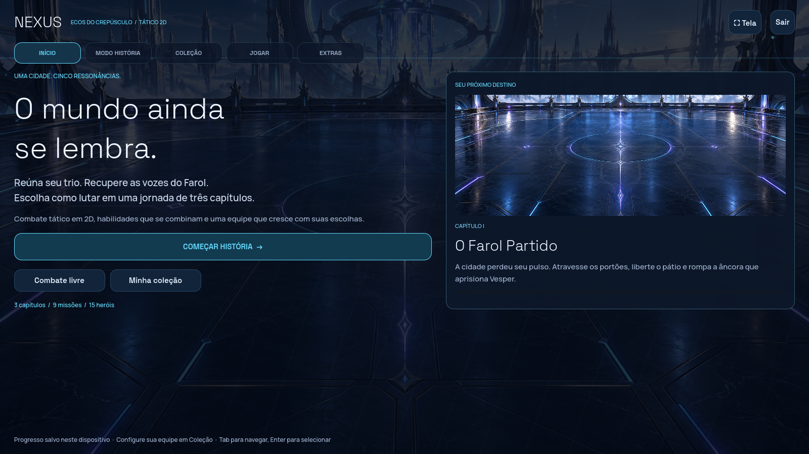

# NEXUS — direção 2D / Alpha 0.10

A apresentação principal voltou ao 2D. Personagens ilustrados, poses, coreografias, ícones, barras independentes e recibos detalhados foram reaproveitados. A campanha e o combate livre usam o mesmo palco 2D. O estudo 3D do Vesper permanece em **Extras → Arquivo 3D · Vesper**; suas fontes e o protótipo de arena continuam no repositório.

## Continuidade Renascimento

A campanha atual tem seis capítulos e 48 missões principais; consulte
[CAMPAIGN.md](CAMPAIGN.md). As referências de nove missões abaixo documentam
a Alpha 0.10. No combate livre e na campanha, **Pular animação** conclui a
apresentação da ação atual com seus efeitos de turno e resultado completo.
O comando não inicia um turno adicional; os controles manuais/automáticos
continuam valendo para a ação seguinte.

**Teclado**, no cabeçalho inicial e nas Opções da batalha, remapeia nove
comandos. Teclas ocupadas trocam suas ações; Esc cancela a captura e
Restaurar teclado volta aos padrões. Os cartões, o rodapé e Automático
exibem as teclas escolhidas. Tab/F11 e a navegação dos menus permanecem
reservados. Preferências antigas usam os atalhos padrão; as escolhas novas
ficam no arquivo de preferências existente, separado do save da campanha.

## Jogar

Abra `project.godot` no **Godot 4.6 Standard** e pressione **F5**. A primeira importação prepara os cenários e as ilustrações.

- **Início:** continuar a campanha ou entrar rapidamente no combate livre.
- **Modo História:** consultar os três capítulos, escolher o trio e iniciar a próxima missão.
- **Coleção:** submenus de heróis/habilidades e engastes/gemas.
- **Jogar:** treino contra IA ou duelo local, com preparação das equipes.
- **Extras:** treinos guiados, galeria, afinidades, laboratório e arquivo do Vesper em 3D.

Use **Tab / Shift+Tab** para navegar, **Enter** para ativar botões e **Esc** para voltar ao início ou abrir a confirmação de saída da batalha. Em tela cheia, o primeiro Esc retorna à janela. A rolagem da história acompanha o controle em foco. Capítulos bloqueados podem ser consultados; suas missões permanecem bloqueadas até a conclusão da etapa anterior.

Nos seletores, use Tab para focar, Espaço para abrir, setas para percorrer e
Enter para confirmar. Abertura pelo teclado conserva o item selecionado em
foco. Depois de abrir pelo mouse, a primeira seta pode apenas focar o primeiro
item; confira o destaque antes de confirmar. Na galeria, Escape fecha a lista
sem sair da demonstração. Esse percurso foi conferido no Chrome local em
duas resoluções no ensaio 79, sem alterar a interface ou o motor.

## História na Alpha 0.10

| Capítulo | Missões | Cenário e atmosfera |
| --- | --- | --- |
| I — O Farol Partido | 01–03: portões, pátio, guardião do eclipse | Sanctum, luz fria, névoa e partículas de ressonância |
| II — Marés da Memória | 04–06: escadaria, arquivo submerso, guardiã da memória | Observatório lunar, canais animados, reflexos e chuva fina |
| III — A Última Fornalha | 07–09: estrada das cinzas, relés, último juramento | Forja, distorção de calor, luz âmbar e brasas |

São nove batalhas jogáveis, com relatos antes/depois, dicas, três chefes e uma gema na primeira vitória de cada missão. Os inimigos novos aproveitam ilustrações do elenco em variantes de história; não são novos heróis selecionáveis. A primeira sequência permanece compatível com o progresso anterior. [Regras da campanha e salvamento](CAMPAIGN.md).

## Automático

Ative **Automático · A** no cabeçalho da batalha ou pressione **A**. É possível selecionar o automático antes de iniciar ou durante uma partida. Ele controla a equipe do jogador, respeitando energia, recargas, alvos legais, Provocação e os mesmos valores do combate manual.

A IA prioriza habilidades disponíveis; cura aliados feridos, procura proteção que precise de renovação e usa ataques e supremos contra os alvos escolhidos por suas regras táticas. Ela não prevê todas as combinações possíveis e não garante vitória. Desligar durante uma ação permite que ela termine e devolve o próximo turno ao jogador. Pedidos ainda na espera são cancelados imediatamente.

Confirmações e diálogos pausam novas decisões. Reiniciar e sair invalidam ações antigas. No duelo local, o automático controla apenas a primeira equipe; a segunda continua com a outra pessoa. Treinos guiados mantêm controle manual. Nenhuma missão começa sozinha: confirme **Iniciar missão**.

## Apresentação

Constelação ardente de Cindra acrescenta oito desenhos de preparação baixa,
elevação do arco, tensão/soltura para o céu, acompanhamento e recuperação
(incremento 80). O básico Agulhas de brasa, Sinal escarlate, defesa, derrota
e repouso conservam suas artes e regras. A folha adicional tem RGBA
1774×887/1.239.834 bytes, referenciada na folha básica; prompt/correção/hash
constam em `animation-art.json`, aceite humano falso.

A revisão encontrou emissão usando escala básica em vez da escala do novo
quadro. TDD reproduziu o desalinhamento dos dois lados; Fighter agora usa
a mesma escala efetiva do desenho, com fallback preservado. Passaram nove
casos de transição/geometria (incluindo Kira padrão) e 62 de comportamento
real de Cindra/Kira/Vektor/Nima, com base Rhazen. 55 JS/check, export local
113,4 MiB e nativo quatro casos/duas resoluções/ambos os lados passaram.
Chrome confirmou seleção, preparação própria, golpe e recibos em duas
resoluções. Ensaio complementar aguardou fim da queimadura do supremo e
do básico posterior, confirmando repouso/controles habilitados nas duas.
Standards/Spec reexaminaram o P2 corrigido e terminaram sem achados restantes.
O ensaio nativo preserva duas tentativas expiradas; a última restaura a
visibilidade da janela de fixture quando não pode desenhar. Ator/100 EN
forçados, Wayland/llvmpipe/áudio Dummy; sem aceite humano ou FPS físico.
A integrada ampla mais recente é a do 78; não foi contabilizada como nova
execução 80. Supremos completos dos 24 permanecem abertos.

Queda da fornalha de Rhazen ganhou oito desenhos exclusivos no incremento 78:
agachamento de preparação, elevação vertical, extremo sobre a cabeça, golpe,
contato, assentamento e duas recuperações. O básico, Coração de ferro, guarda,
derrota e repouso conservam suas artes. A folha adicional é RGBA 1774×887 e
1.006.280 bytes, com prompt/correção/hash no manifesto. O Fighter seleciona
folha/escala por quadro e fases por habilidade; o diretor continua dono dos
Tweens e do único impacto. Passaram 26 dirigidos e cinco transições, incluindo
espelhamento, retorno ao básico, pulo/reinício e derrota prioritária.
Inspeção nativa observou os oito quadros em duas resoluções/ambos os lados,
com estado final igual ao motor e um impacto. É fixture com ator/100 EN
forçados, Wayland/llvmpipe e áudio Dummy mudo; não é aceite humano.
Passaram 55 JS, check, integrada com 286 coreografias/cinco transições,
1.301 nativos/1.272 UI, paridade de 36 partidas e replay de 282 logs. Export
local de 112,6 MiB; Chrome em duas resoluções confirmou seleção, preparação
própria, golpe, recibos e retorno ao básico/repouso. A primeira seleção por
teclas ficou em Veyra e foi preservada como inválida; repetição por mouse
selecionou Rhazen. Standards/Spec do delta sem achados. Os supremos dos
demais personagens e as animações completas permanecem abertos.

Elun e Saira ampliam a dez as folhas corporais expandidas. Corte Prismático
e Paradoxo usam o golpe desenhado de Elun; Trama Impossível mantém proteção.
Saira lança Runa Cintilante e usa a postura de cura em Maré de Éter e Coro
das Constelações. Guarda e derrota são próprias, com repousos preservados.

Elyra, Solen e Zaya completam os 24 perfis corporais de oito desenhos
(192 desenhos), referenciados em `lumi-three.png`. Cajado/palma/arco têm
fases próprias; curas, barreiras e energia conservam suporte. A seleção
corrige fundos/auras e margens; prompts integrais e as três correções de
Elyra constam no manifesto, com hashes e aceite humano falso. Repousos e
kits preservados. Passaram 55 testes JS e export local de 111,9 MiB;
inspeções nativa/Chrome concluídas, suíte completa/ensaio em fechamento.
Revisões Standards/Spec de 60/61 e documentos concluídas sem achados. Os supremos finais e aceite humano continuam.

Noct, Maura e Riven ampliam a 21 os perfis de oito desenhos. Garras, adagas
e magia têm fases próprias; Pacto continua ataque com cura secundária e
Réquiem permanece suporte. As fontes selecionadas corrigem halos, preservando
as candidatas e repousos. Prompts/correções/hashes ficam no manifesto.
Passaram 60 casos dirigidos, 110 de derrota, JS e build Web de 109,5 MiB.
Inspeções nativas e Chrome em duas resoluções concluídas pelo agente;
revisões Standards/Spec de 60/61 concluídas sem achados.
Sem aceite humano ou conclusão dos supremos finais.

Torv, Brin, Bast e Ivo levam a 18 os perfis corporais de oito desenhos,
referenciados em `returned-five.png`. Punhos/cortes têm fases próprias;
curas de Brin e escudos de Bast conservam suporte. As folhas selecionadas
corrigem margens e transparência. Prompts, correções, hashes e bytes estão
em `animation-art.json`; repousos e kits preservados. Passaram 72 verificações
dirigidas e 110 de derrota, checagens JS e export Web de 107,3 MiB. Inspeção
nativa Godot/llvmpipe e galerias Chrome em duas resoluções concluídas pelo
agente. Revisões Standards/Spec de 55/56/58/59 concluídas sem achados no 59,
encerrando as pendências anteriores. Aceite humano permanece pendente.

Veyra, Sylva, Vesper e Auren ampliam para 14 os perfis corporais de oito
desenhos, usando as artes originais individuais. Lâminas, cajado, foice e lança
mantêm identidades; curas/proteções seguem seus kits. As folhas selecionadas
corrigem margem da foice e transparência de Sylva (versão 2), preservando a
candidata rejeitada nas evidências. Repousos e motor permanecem.
Passaram 164 casos de coreografia; após a correção de Sylva, 36 selecionados
com base Rhazen/Cindra e 110 de derrota. Build final de 104,4 MiB, inspeções
Godot/llvmpipe e galerias Chrome em 1600×900/1280×720 concluídos pelo agente.
Manifesto contém prompts, correções e hashes. Revisão independente pendente
por limite de uso; sem aceite humano ou conclusão das animações dos 24.

Axion e Astra levam a oito as folhas corporais expandidas. Lâmina de Pulso
usa o corte desenhado de Axion; Campo de Contenção e Protocolo Zero mantêm
postura protetora. Astra reúne e lança as esferas em seus três ataques.
Ambos têm guarda, recuperação e derrota próprias, com repousos preservados.
As folhas selecionadas corrigem margens da espada e das esferas.

Kira e Vektor ampliam a estrutura para seis folhas corporais de oito desenhos.
Kira prepara, dispara e recupera o rifle nos três ataques; Vektor comanda
seus três drones no básico e mantém a postura de suporte nas duas habilidades.
Guarda e derrota têm desenhos próprios. Pontos de emissão opcionais nos
quadros fazem o projétil partir do rifle/drone, também no lado espelhado.
O Fighter invalida interpolações de fases antigas quando recebe outra fase
ou restauração. A galeria reserva espaço acima dos desenhos durante o ataque.
Derrotados usam uma única atenuação de opacidade, conservando a silhueta legível.
O kit, a ilustração de repouso e o resultado do combate permanecem.

Oren e Nima acrescentam duas folhas de oito desenhos à estrutura corporal.
Âncora de Carvalho prepara e desfere o golpe pesado; Raízes Entrelaçadas e
Despertar da Floresta conservam a proteção. Nima tensiona e dispara seu arco
em Flecha Silvestre, Espinho Perfurante e Mil Espinhos. Ambos têm guarda,
recuperação e derrota desenhadas, com tempos próprios. As artes de repouso,
regras e seleção livre continuam nos donos existentes.

Cindra usa a mesma estrutura com uma folha própria de oito quadros: erguer o
arco, tensionar, disparar, acompanhar e recuperar, além de proteção e derrota.
Sinal Escarlate continua sendo suporte de equipe, com postura protetora;
Agulhas de Brasa e Constelação Ardente usam a sequência do arco. Nenhum
parâmetro de combate mudou. Rhazen e Cindra preservam seus repousos originais.

Rhazen ganhou uma folha adicional com oito poses corporais: preparação em
dois estágios, golpe descendente, contato no chão, recuperação, defesa e
derrota ajoelhada. Ataque e supremo percorrem os desenhos com tempos próprios;
Coração de Ferro mantém a postura defensiva. O impacto continua único.
Pulo/cancelamento encerram também a troca de quadros, e movimentos reduzidos
usam o caminho imediato. O repouso original permanece. Os detalhes de arte
e seus limites estão em [Personagens 2D](assets/characters/README.md).

A pose final de derrota permanece quando começa outra ação.
Pular a ação, reduzir movimentos e reapresentar um estado morto chegam à
mesma pose final, conservando a ficha com vida zero. Isso também vale para
morte por efeitos de turno ou reflexão. Reiniciar restaura as poses vivas.
Este ajuste de continuidade não encerra as animações completas do elenco.

Os cenários usam pintura, névoa em camadas, luz, partículas e animação de materiais. Os golpes combinam faixas contínuas de lâmina, fogo turbulento, ondas de maré, energia, sombra, proteção e partículas arredondadas. Os supremos preservam as pinturas anteriores como uma camada discreta sob os novos efeitos. A maré de Saira tem seu próprio tratamento ciano.

O contato dispara uma única atualização do resultado. Uma onda breve de distorção e separação de cor dá resposta de tela, mantendo os medidores acima desse efeito. **Reduzir animações** congela a atmosfera e desliga essas distorções, além de encurtar ações. Os dez sons foram refeitos com camadas de ar filtrado, corpo e cauda curta; o som continua opcional.

Os recibos mostram valores reais do motor: dano à vida, dano e saldo do escudo quando pertinente, cura, energia, crítico e efeitos positivos/negativos com duração. O posicionamento considera cartões de recursos e silhuetas. O **Registro** preserva os detalhes depois que as janelas desaparecem.

## Aprender: cinco batalhas guiadas

Aprender oferece cinco batalhas guiadas: as três anteriores e purificação/
Égide, transmissão de aflições/interceptação. Os recibos reais marcam objetivos;
proteção sem remoção ou ataque sem aflição não simulam progresso. Lista rolável,
foco acompanhado e estados textuais Pendente/Feito atendem as resoluções
1280×720/1600×900. Opções ficam indisponíveis no PvP com explicação; ao sair,
trios, modo e dificuldade livres voltam, sem gravar campanha ou registros.
Passaram 33 casos dirigidos e seis simulações legais de objetivos (três sementes
por lição, seis ações cada), integrada 1.301/1.272 UI e paridade/replays. Export
local de 111,9 MiB e inspeções nativa/Web concluídos, com a quinta lição em 2/2
por teclado/ordem natural e movimento reduzido escolhido na interface. Revisões
Standards/Spec sem achados. A integrada rodou 27 dirigidos; os 33 finais incluem
seis casos legais acrescentados depois. Sem aceite humano ou mudança de kits/saves.

## Verificação e prévias

```bash
npm test
npm run test:godot
# Em um display com OpenGL:
godot --audio-driver Dummy --path godot --fixed-fps 30 --script res://tests/capture_2d.gd -- "$PWD/artifacts/2d-review"
```

A suíte cobre as nove missões, recompensas únicas, migração do progresso, navegação, controle automático, reinício e saída; também executa os testes de combate/interface/paridade e os estudos 3D preservados. Captura visual exige um display. Em uma máquina sem diretório pessoal gravável, configure as três variáveis `XDG_*_HOME` como explicado em [GRAPHICS-3D.md](GRAPHICS-3D.md).



[História](../docs/2d-preview/story-2.png) · [Combate 2D](../docs/2d-preview/battle-2d.png) · [Fogo](../docs/2d-preview/fire-hit.png) · [Maré e cura](../docs/2d-preview/water-heal.png) · [Vídeo dos golpes](../docs/2d-preview/combat-showcase.mp4)

As prévias vêm do Godot, com cenários de revisão em memória. Elas não alteram o progresso do jogador. O vídeo é uma gravação por quadros, sem áudio; sua reprodução não é uma medição de desempenho em GPU.
