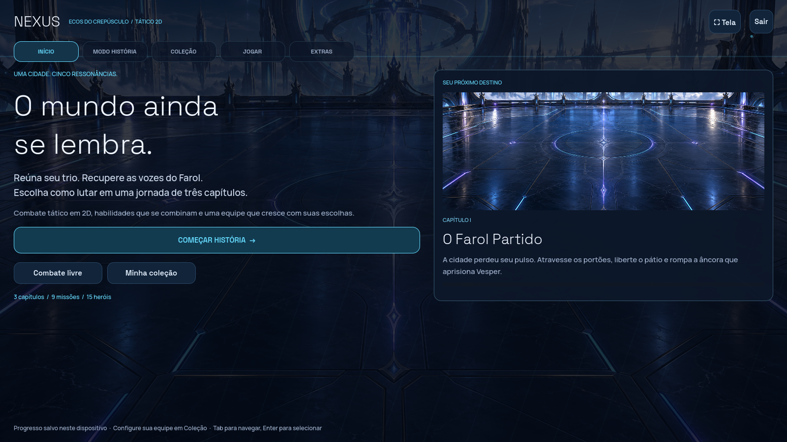

# NEXUS — direção 2D / Alpha 0.10

A apresentação principal voltou ao 2D. Personagens ilustrados, poses, coreografias, ícones, barras independentes e recibos detalhados foram reaproveitados. A campanha e o combate livre usam o mesmo palco 2D. O estudo 3D do Vesper permanece em **Extras → Arquivo 3D · Vesper**; suas fontes e o protótipo de arena continuam no repositório.

## Jogar

Abra `project.godot` no **Godot 4.6 Standard** e pressione **F5**. A primeira importação prepara os cenários e as ilustrações.

- **Início:** continuar a campanha ou entrar rapidamente no combate livre.
- **Modo História:** consultar os três capítulos, escolher o trio e iniciar a próxima missão.
- **Coleção:** submenus de heróis/habilidades e engastes/gemas.
- **Jogar:** treino contra IA ou duelo local, com preparação das equipes.
- **Extras:** treinos guiados, galeria, afinidades, laboratório e arquivo do Vesper em 3D.

Use **Tab / Shift+Tab** para navegar, **Enter** para ativar botões e **Esc** para voltar ao início ou abrir a confirmação de saída da batalha. Em tela cheia, o primeiro Esc retorna à janela. A rolagem da história acompanha o controle em foco. Capítulos bloqueados podem ser consultados; suas missões permanecem bloqueadas até a conclusão da etapa anterior.

## História

| Capítulo | Missões | Cenário e atmosfera |
| --- | --- | --- |
| I — O Farol Partido | 01–03: portões, pátio, guardião do eclipse | Sanctum, luz fria, névoa e partículas de ressonância |
| II — Marés da Memória | 04–06: escadaria, arquivo submerso, guardiã da memória | Observatório lunar, canais animados, reflexos e chuva fina |
| III — A Última Fornalha | 07–09: estrada das cinzas, relés, último juramento | Forja, distorção de calor, luz âmbar e brasas |

São nove batalhas jogáveis, com relatos antes/depois, dicas, três chefes e uma gema na primeira vitória de cada missão. Os inimigos novos aproveitam ilustrações do elenco em variantes de história; não são novos heróis selecionáveis. A primeira sequência permanece compatível com o progresso anterior. [Regras da campanha e salvamento](CAMPAIGN.md).

## Automático

Ative **Automático · A** no cabeçalho da batalha ou pressione **A**. É possível selecionar o automático antes de iniciar ou durante uma partida. Ele controla a equipe do jogador, respeitando energia, recargas, alvos legais, Provocação e os mesmos valores do combate manual.

A IA prioriza habilidades disponíveis; cura aliados feridos, procura proteção que precise de renovação e usa ataques e supremos contra os alvos escolhidos por suas regras táticas. Ela não prevê todas as combinações possíveis e não garante vitória. Desligar durante uma ação permite que ela termine e devolve o próximo turno ao jogador. Pedidos ainda na espera são cancelados imediatamente.

Confirmações e diálogos pausam novas decisões. Reiniciar e sair invalidam ações antigas. No duelo local, o automático controla apenas a primeira equipe; a segunda continua com a outra pessoa. Treinos guiados mantêm controle manual. Nenhuma missão começa sozinha: confirme **Iniciar missão**.

## Apresentação

Os cenários usam pintura, névoa em camadas, luz, partículas e animação de materiais. Os golpes combinam faixas contínuas de lâmina, fogo turbulento, ondas de maré, energia, sombra, proteção e partículas arredondadas. Os supremos preservam as pinturas anteriores como uma camada discreta sob os novos efeitos. A maré de Saira tem seu próprio tratamento ciano.

O contato dispara uma única atualização do resultado. Uma onda breve de distorção e separação de cor dá resposta de tela, mantendo os medidores acima desse efeito. **Reduzir animações** congela a atmosfera e desliga essas distorções, além de encurtar ações. Os dez sons foram refeitos com camadas de ar filtrado, corpo e cauda curta; o som continua opcional.

Os recibos mostram valores reais do motor: dano à vida, dano e saldo do escudo quando pertinente, cura, energia, crítico e efeitos positivos/negativos com duração. O posicionamento considera cartões de recursos e silhuetas. O **Registro** preserva os detalhes depois que as janelas desaparecem.

## Verificação e prévias

```bash
npm test
npm run test:godot
# Em um display com OpenGL:
godot --audio-driver Dummy --path godot --fixed-fps 30 --script res://tests/capture_2d.gd -- "$PWD/artifacts/2d-review"
```

A suíte cobre as nove missões, recompensas únicas, migração do progresso, navegação, controle automático, reinício e saída; também executa os testes de combate/interface/paridade e os estudos 3D preservados. Captura visual exige um display. Em uma máquina sem diretório pessoal gravável, configure as três variáveis `XDG_*_HOME` como explicado em [GRAPHICS-3D.md](GRAPHICS-3D.md).



[História](../docs/2d-preview/story-2.png) · [Combate 2D](../docs/2d-preview/battle-2d.png) · [Fogo](../docs/2d-preview/fire-hit.png) · [Maré e cura](../docs/2d-preview/water-heal.png) · [Vídeo dos golpes](../docs/2d-preview/combat-showcase.mp4)

As prévias vêm do Godot, com cenários de revisão em memória. Elas não alteram o progresso do jogador. O vídeo é uma gravação por quadros, sem áudio; sua reprodução não é uma medição de desempenho em GPU.
