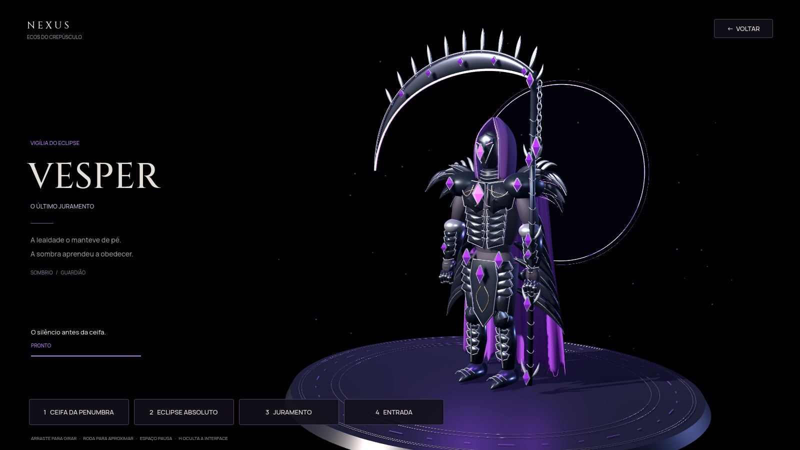

# Vesper — O último juramento

Estudo de arte e animação de um único personagem. O Vesper recebeu um modelo próprio, esqueleto, materiais e seis animações, usando a ilustração encapuzada já existente no projeto como referência de identidade. O jogo principal voltou ao 2D; este estudo permanece arquivado e executável em Extras.



[Vídeo das animações](../docs/vesper-preview/vesper-showcase.mp4) · [Invocação do eclipse](../docs/vesper-preview/vesper-eclipse-charge.png) · [Dano e cura do supremo](../docs/vesper-preview/vesper-eclipse-impact.png) · [Proteção e efeitos positivos](../docs/vesper-preview/vesper-juramento.png)

As prévias foram renderizadas pelo próprio Godot. O vídeo foi gravado quadro a quadro a 24 fps, sem áudio; sua reprodução não mede a taxa de quadros do jogo nesta máquina.

## Abrir

Importe `project.godot` no Godot 4.6 Standard, pressione **F5** e escolha **Extras → Arquivo 3D · Vesper**. Também é possível abrir `scenes/vesper/atelier.tscn` e executar essa cena com **F6**.

- **1 — Ceifa da penumbra:** preparação, giro de tronco, avanço, arco da foice e recuperação.
- **2 — Eclipse absoluto:** invocação, aproximação de câmera, energia na mão, golpe e dissipação.
- **3 — Juramento:** gesto defensivo e apresentação dos efeitos de proteção.
- **4 — Entrada:** reinicia a apresentação e interrompe a sequência anterior.
- **Espaço:** pausa/retoma a animação. **H:** oculta/restaura a interface.
- Arraste sobre o cenário para girar o personagem; use a roda para aproximar ou afastar.
- **Esc / Voltar:** retorna ao menu do jogo.

O ateliê usa alvos de treino invisíveis para calcular os exemplos das janelas flutuantes pelo motor real: a ceifa usa o ataque básico, a proteção usa Guarda do eclipse e o supremo usa Eclipse absoluto. A janela de dano acompanha Oren; a cura do supremo inclui o dreno nos três inimigos do exemplo. Vesper começa com 300 de vida a menos para demonstrar também essa cura própria, em uma janela separada. Isso não avança partidas, campanha, gemas ou progressão. A integração com a arena 3D também permanece no código e nos testes. O combate principal usa novamente as ilustrações e poses 2D.

## Direção de arte

Capuz esculpido, máscara escura com um fragmento de alma, armadura negra sobreposta, frisos de prata, ombreiras com penas forjadas e um tabardo central. A foice tem lâmina curva sólida, fio violeta, incrustações e uma corrente de elos modelados. A capa tem quatro painéis com dobras e barras irregulares, deformados por doze ossos dedicados. Metais, tecido, couro, recessos e cristais usam materiais separados.

A apresentação usa um palco escuro, uma coroa de eclipse, iluminação fria e violeta e controles discretos. Rastros são amostrados de marcadores presos à arma animada. A câmera acompanha o preparo do supremo; o contato dispara uma única resolução dos recibos.

Este é um estudo 3D executável e editável. O refinamento de modelagem, tecidos, mãos, poses e efeitos pode continuar sobre esse arquivo; a validação nesta máquina não representa uma medição de desempenho em GPU de jogador.

## Arquivos e edição

| Arquivo | Conteúdo |
| --- | --- |
| `assets/models/vesper/vesper.glb` | Modelo pronto para Godot, materiais, skin e animações |
| `../art-source/vesper.blend` | Fonte editável em Blender 4.3 ou superior |
| `../scripts/art/build_vesper.py` | Construção reprodutível da geometria, materiais, esqueleto e animações |
| `scripts/vesper/vesper_atelier.gd` | Palco, iluminação, câmera, controles, rastros e recibos |
| `scripts/vesper/vesper_champion.gd` | Integração do mesmo asset com a batalha existente |

O asset é original do projeto, sem modelos, texturas ou pacotes de animação externos. Para jogar, Blender não é necessário: importe o GLB pelo Godot. Para reconstruir a fonte:

```bash
blender -b --factory-startup -t 4 --python scripts/art/build_vesper.py
```

O GLB contém **32 ossos** e os clipes `Vesper_Idle` (4,8 s), `Vesper_Arrival` (3,8 s), `Vesper_ReapingArc` (3,6 s), `Vesper_Eclipse` (5,4 s), `Vesper_Ward` (3,6 s) e `Vesper_Hit` (1,2 s), amostrados a 30 quadros por segundo. O repouso fecha em loop; os movimentos de capa têm defasagem entre segmentos.

## Verificar e capturar

```bash
npm test
npm run test:godot
godot --headless --audio-driver Dummy --path godot --script res://tests/vesper.gd
godot --path godot --script res://tests/vesper_capture.gd -- "$PWD/artifacts/vesper-review"
```

Os testes verificam mudanças reais dos ossos e dos marcadores da arma, movimento de capa, fechamento do loop, pausa, contatos únicos, reinício, retorno ao menu e preservação da campanha. O teste anterior da cena 3D verifica também o uso do modelo no elenco e nas missões.

Para gravar quadros pelo renderizador do próprio Godot, acrescente `--fixed-fps 30 --write-movie /tmp/vesper-movie/frame.png` à execução da captura. Capturas exigem um display com OpenGL; testes sem interface não validam a qualidade visual.
